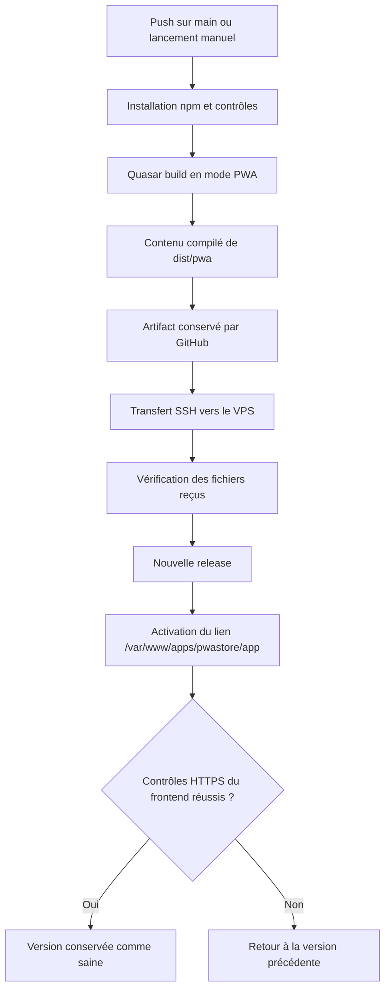

<div align="center">


# PWA Store · Frontend

**Découvrir, utiliser et publier des applications Web depuis une même interface.**

Vue 3 · Quasar · PWA · GitHub Actions · Nginx

[Guide utilisateur](docs/PWASTORE_USER_GUIDE_FR.md) · [Guide de publication](docs/PWASTORE_DEVELOPER_GUIDE_FR.md) · [Installation sur le VPS](docs/DEPLOYMENT.md)

</div>

---

## Bienvenue

Ce dépôt contient le **frontend de PWA Store** : les pages, les boutons, les formulaires et la navigation que les utilisateurs voient dans leur navigateur.

L’application permet de parcourir un catalogue d’applications Web, d’utiliser un compte et d’accéder aux espaces développeur et administration, selon les droits de chaque personne. Elle est construite avec **Vue** et **Quasar**, et peut être compilée en **PWA**, une application Web installable sur les appareils compatibles.

Le backend **Laravel** est un projet séparé. Il fournit les données, gère les comptes et applique les autorisations. Il n’est pas inclus dans ce dépôt.

> **À retenir pour le déploiement**
>
> GitHub compile d’abord le frontend avec `quasar build -m pwa`, via `npm run build:pwa`. Il envoie ensuite **le contenu compilé de `dist/pwa/`**, avec ses métadonnées de version, sur le VPS. Nginx sert le site depuis **`/var/www/apps/pwastore/app`**.
>
> La compilation se fait sur GitHub Actions. Il n’est pas nécessaire d’installer Node.js ou Quasar sur le VPS pour servir ce frontend.

## Sommaire

- [1. Comprendre les mots utilisés](#1-comprendre-les-mots-utilisés)
- [2. Les adresses et les dossiers importants](#2-les-adresses-et-les-dossiers-importants)
- [3. Installer le projet sur son ordinateur](#3-installer-le-projet-sur-son-ordinateur)
- [4. Lancer le frontend en développement](#4-lancer-le-frontend-en-développement)
- [5. Compiler le projet pour la production](#5-compiler-le-projet-pour-la-production)
- [6. Comprendre le déploiement automatique](#6-comprendre-le-déploiement-automatique)
- [7. Préparer le premier déploiement](#7-préparer-le-premier-déploiement)
- [8. Publier une mise à jour](#8-publier-une-mise-à-jour)
- [9. Vérifier le site et revenir en arrière](#9-vérifier-le-site-et-revenir-en-arrière)
- [10. Comprendre les mises à jour PWA](#10-comprendre-les-mises-à-jour-pwa)
- [11. Se repérer dans le code](#11-se-repérer-dans-le-code)
- [12. Les commandes utiles](#12-les-commandes-utiles)
- [13. Résoudre les problèmes courants](#13-résoudre-les-problèmes-courants)
- [14. Aller plus loin](#14-aller-plus-loin)

## 1. Comprendre les mots utilisés

| Mot                           | Explication simple                                                                                                                         |
| ----------------------------- | ------------------------------------------------------------------------------------------------------------------------------------------ |
| **Frontend**                  | La partie de l’application affichée dans le navigateur. C’est ce projet.                                                                   |
| **Backend / API**             | Le service qui reçoit les demandes du frontend et renvoie les données. Ici, c’est Laravel.                                                 |
| **PWA**                       | Une application Web que le navigateur peut proposer d’installer. Certaines ressources peuvent être conservées pour fonctionner hors ligne. |
| **Build / compilation**       | L’opération qui transforme le code de développement en fichiers prêts à être servis aux utilisateurs.                                      |
| **VPS**                       | Le serveur distant sur lequel le site est hébergé.                                                                                         |
| **Nginx**                     | Le logiciel du serveur qui transmet les fichiers du site aux navigateurs.                                                                  |
| **GitHub Actions / workflow** | Une suite de tâches automatiques décrites dans un fichier du dépôt.                                                                        |
| **Artifact**                  | Un ensemble de fichiers conservé par GitHub Actions entre deux étapes. Ici, il contient le frontend compilé.                               |
| **Release**                   | Une version compilée du site, conservée sur le serveur.                                                                                    |
| **Rollback**                  | Le retour à une version précédente lorsque la nouvelle présente un problème.                                                               |
| **SSH**                       | La connexion sécurisée utilisée pour communiquer avec le VPS.                                                                              |
| **Secret GitHub**             | Une valeur confidentielle, comme une clé privée SSH, enregistrée dans les paramètres GitHub.                                               |

## 2. Les adresses et les dossiers importants

| Élément                   | Adresse ou chemin                                 | Utilité                                                                    |
| ------------------------- | ------------------------------------------------- | -------------------------------------------------------------------------- |
| Site public               | `https://pwastore.online`                         | L’adresse utilisée par les visiteurs.                                      |
| Serveur API               | `https://api.pwastore.online`                     | Le domaine du backend Laravel.                                             |
| Base des appels API       | `https://api.pwastore.online/api`                 | L’adresse intégrée au build du frontend. Le suffixe `/api` est nécessaire. |
| VPS LWS                   | `213.156.133.235`                                 | L’adresse du serveur Debian 12.                                            |
| **Site actif sur le VPS** | **`/var/www/apps/pwastore/app`**                  | **Le chemin que Nginx utilise pour servir le frontend.**                   |
| Versions conservées       | `/var/www/apps/pwastore/releases`                 | Les builds disponibles pour activation ou rollback.                        |
| Transferts temporaires    | `/var/www/apps/pwastore/shared/frontend/incoming` | Les fichiers reçus avant leur vérification.                                |
| Backend existant          | `/var/www/apps/pwastore/api`                      | Le projet Laravel, géré séparément.                                        |

Le workflow frontend gère ses versions et son lien actif. Il ne déploie pas le backend, ne lance pas de migration de base de données et ne gère pas les autres projets du VPS.

## 3. Installer le projet sur son ordinateur

### Ce qu’il faut avoir

- **Git**, pour récupérer le code.
- **Node.js 24.14.1**, la version indiquée dans [`.nvmrc`](.nvmrc).
- **npm**, fourni avec Node.js, pour installer les dépendances.
- Un éditeur de code et un navigateur récent.
- Une API Laravel accessible pour tester les fonctions qui utilisent les données ou un compte.

Le projet utilise **npm**. Les fichiers `package-lock.json` et `src-pwa/package-lock.json` enregistrent les dépendances à installer. Utiliser `npm ci` permet de respecter ces fichiers et de reproduire l’installation utilisée sur GitHub.

### Récupérer le code

Dans un terminal :

```bash
git clone https://github.com/paulus15/oneappapp.git
cd oneappapp
```

Si le dépôt est privé, GitHub demande une authentification avec un compte autorisé.

### Choisir Node.js et installer les dépendances

Si **nvm** est déjà installé sur votre machine macOS ou Linux :

```bash
nvm install
nvm use
```

Sans nvm, installer la version de Node.js indiquée dans `.nvmrc` avec votre méthode habituelle, puis vérifier :

```bash
node --version
npm --version
```

Installer ensuite les deux ensembles de dépendances :

```bash
npm ci
npm ci --prefix src-pwa
```

La première commande installe les outils du frontend. La seconde installe Workbox, utilisé pour générer le service worker de la PWA. La préparation de Quasar est lancée automatiquement par l’installation principale.

## 4. Lancer le frontend en développement

Depuis la racine du projet :

```bash
npm run dev
```

Quasar démarre le serveur de développement et affiche son adresse dans le terminal. Ouvrir cette adresse pour voir l’application. Les modifications du code sont prises en compte pendant le développement. Pour arrêter le serveur, utiliser **Ctrl+C**.

La configuration actuelle active HTTPS pour le développement. Selon la configuration locale, le navigateur peut demander de faire confiance au certificat de développement.

### Choisir l’API utilisée

Sans variable particulière, le projet utilise l’adresse locale historique `https://oneapp.test/api`. Ce nom doit correspondre à un backend configuré sur votre machine.

Pour utiliser une autre API de développement, définir `VITE_API_URL` **avant** de démarrer Quasar.

**macOS / Linux :**

```bash
VITE_API_URL=https://oneapp.test/api npm run dev
```

**Windows PowerShell :**

```powershell
$env:VITE_API_URL = "https://oneapp.test/api"
npm run dev
```

L’exemple suppose qu’une API HTTPS est déjà accessible sur cette adresse. Ces commandes ne démarrent pas Laravel. **Le frontend et l’API doivent utiliser HTTPS, même en développement**, et l’origine exacte du frontend (protocole, hôte, port) doit correspondre à `PWA_FRONTEND_URL` côté Laravel. Le mode cookie utilise aussi les autorisations CORS avec credentials.

Le frontend lit cette valeur dans `quasar.config.js`, puis l’intègre à sa configuration Axios et à sa politique de sécurité. Pour ce projet, utiliser les variables du terminal comme dans les exemples ; créer seulement un fichier `.env.production` ne garantit pas leur prise en compte.

> L’URL de l’API est publique. Un mot de passe, une clé Laravel ou un jeton privé ne doit jamais être intégré aux variables du frontend : les fichiers compilés peuvent être téléchargés par les visiteurs.

### Comment fonctionne l’authentification

Le navigateur transmet le cookie HttpOnly/Secure avec `withCredentials: true` et l’en-tête `X-PWA-Auth: cookie`. La connexion, l’OTP et la réinitialisation n’attendent plus de `access_token`. Les anciens jetons stockés dans JavaScript sont supprimés ; le compte reste en mémoire et sa session est vérifiée avec `/auth/me`. Les téléchargements de justificatifs utilisent la même instance API.

La déconnexion appelle le serveur avant de vider l’état local. En cas de panne réseau, un message indique que la session peut rester active : JavaScript ne peut pas effacer lui-même un cookie HttpOnly. Voir [les contrôles avant production](docs/AUTH_COOKIE.md).

## 5. Compiler le projet pour la production

### La commande utilisée pour le site en ligne

Le déploiement utilise le **mode PWA** :

```bash
PWA_REQUIRE_API_URL=1 \
VITE_API_URL=https://api.pwastore.online/api \
npm run build:pwa
```

`npm run build:pwa` exécute la commande Quasar suivante :

```bash
quasar build -m pwa
```

**Sous Windows PowerShell :**

```powershell
$env:PWA_REQUIRE_API_URL = "1"
$env:VITE_API_URL = "https://api.pwastore.online/api"
npm run build:pwa
```

`PWA_REQUIRE_API_URL=1` fait échouer le build si l’adresse de l’API manque. Cela évite de publier accidentellement une version qui pointe sur l’API locale d’un développeur.

### Ce que produit la compilation

Après un build PWA réussi, les fichiers sont dans :

```text
dist/pwa/
├── index.html          # La page d’entrée du site
├── assets/             # JavaScript, CSS, polices et autres ressources compilées
├── icons/              # Icônes du navigateur et de l’installation PWA
├── brand/              # Visuels publics de la marque
├── manifest.json       # Nom, icônes et paramètres d’installation de la PWA
├── sw.js               # Service worker généré par Workbox
└── …                   # Autres fichiers nécessaires au site
```

GitHub ajoute ensuite `release.json`, qui identifie le commit déployé et contient les empreintes des fichiers. Ce fichier permet de vérifier l’intégrité du transfert et la version servie.

**C’est le contenu de `dist/pwa/` qui est envoyé, sans ajouter de dossier `dist/pwa` dans la racine du site.** Le résultat est accessible à l’emplacement :

```text
/var/www/apps/pwastore/app/index.html
/var/www/apps/pwastore/app/assets/…
/var/www/apps/pwastore/app/manifest.json
/var/www/apps/pwastore/app/sw.js
```

Le transfert du site n’inclut pas le dépôt Git, `src/`, `node_modules/`, les fichiers `.env` ou les tests. Le script de commande du déploiement est exécuté séparément via SSH, sans être placé dans le dossier public.

### Différence entre les deux commandes de build

| Commande npm            | Commande Quasar           | Dossier produit | Usage                                                      |
| ----------------------- | ------------------------- | --------------- | ---------------------------------------------------------- |
| `npm run build`         | `quasar build`            | `dist/spa/`     | Application Web en mode SPA.                               |
| **`npm run build:pwa`** | **`quasar build -m pwa`** | **`dist/pwa/`** | **Version PWA utilisée par le déploiement de production.** |

### Voir le résultat compilé sur son ordinateur

Après la compilation, utiliser le petit serveur statique déjà présent dans le dépôt :

```bash
node test/e2e/serve.mjs dist/pwa 9124
```

Ouvrir `http://127.0.0.1:9124`. Cette commande sert les fichiers compilés et permet les routes de l’application ; elle ne lance pas les tests E2E. Arrêter le serveur avec **Ctrl+C**.

Cette prévisualisation HTTP sert uniquement à examiner les fichiers et l’interface : elle ne convient pas à la validation de l’authentification cookie. Pour celle-ci, servir le frontend et l’API en HTTPS avec des certificats locaux, comme décrit dans le [plan de test](docs/PWASTORE_TEST_PLAN.md#8-validation-du-mode-cookie-https). Cette prévisualisation ne reproduit pas les règles de cache de Nginx. Ne pas ouvrir directement `index.html` par double-clic : l’application doit être servie par HTTP ou HTTPS.

## 6. Comprendre le déploiement automatique

Le fichier à consulter est **[`.github/workflows/deploy-production.yml`](.github/workflows/deploy-production.yml)**. Il contient deux jobs : `build`, qui prépare les fichiers, puis `deploy`, qui les met en ligne.



### Première étape : préparer les fichiers sur GitHub

Le job `build` :

1. Récupère le code correspondant au commit.
2. Installe la version de Node.js définie dans `.nvmrc`.
3. Installe les dépendances avec les deux fichiers lock.
4. Vérifie le formatage et le code, puis lance les tests unitaires.
5. Compile le frontend en PWA avec l’URL de production de l’API.
6. Vérifie le HTML, les fichiers JavaScript et CSS, le manifeste, le worker et les icônes.
7. Ajoute les métadonnées de version et exécute les tests du mécanisme de déploiement.
8. Conserve uniquement le dossier compilé comme artifact.

Si une étape échoue, le job de déploiement ne démarre pas.

### Deuxième étape : envoyer puis activer le build sur le VPS

Le job `deploy` télécharge l’artifact produit par `build`. Le script [upload.sh](scripts/deploy/upload.sh) transfère **le contenu de cet artifact**, avec rsync sur une connexion SSH dont la clé d’hôte est vérifiée.

Les fichiers arrivent d’abord dans un dossier temporaire propre à la nouvelle version. Le script [remote.py](scripts/deploy/remote.py) contrôle leurs empreintes, prépare la release, puis remplace le lien actif `app`. La version précédente reste disponible pendant le transfert.

### Pourquoi `app` est un lien symbolique

Un lien symbolique est comparable à un raccourci de dossier. Le chemin public reste toujours :

```text
/var/www/apps/pwastore/app
```

Mais il pointe sur le dossier de la version active :

```text
/var/www/apps/pwastore/
├── app ───────────────► releases/<version-active>/
├── releases/
│   ├── <version-précédente>/
│   └── <version-active>/
├── shared/
│   └── frontend/
│       ├── incoming/   # Transferts en préparation
│       └── healthy/    # Versions ayant réussi les contrôles
└── api/                # Backend Laravel existant
```

Ainsi, Nginx lit toujours `/var/www/apps/pwastore/app/index.html`. Le remplacement du lien est **atomique** : la bascule se fait en une opération, après réception de tous les fichiers. Cela évite de remplacer progressivement les fichiers du site pendant que des visiteurs le consultent.

Les cinq dernières versions validées sont conservées. La sauvegarde initiale et les transferts échoués sont conservés séparément pour diagnostic. Aucun redémarrage de Nginx n’est nécessaire lors d’un déploiement statique normal.

## 7. Préparer le premier déploiement

Cette préparation se fait **une seule fois**, avant le premier lancement vers la production. Les commandes administrateur sont détaillées dans **[le guide VPS](docs/DEPLOYMENT.md)**.

### Sur le VPS

- Créer l’utilisateur SSH dédié `pwastore-deploy`, sans droits sudo pour le déploiement automatique.
- Préparer les dossiers et leurs permissions.
- Installer la clé publique SSH et vérifier l’empreinte du serveur.
- Sauvegarder le frontend actuel et convertir `app` en lien symbolique avec la procédure de migration.
- Configurer le vhost HTTPS de `pwastore.online` avec le [fragment Nginx fourni](deploy/nginx/pwastore-frontend.conf).
- Vérifier que l’API répond et autorise les appels provenant de `https://pwastore.online`.

Le fragment Nginx se place dans le bloc HTTPS existant du frontend. Il contient notamment :

```nginx
root /var/www/apps/pwastore/app;
```

Il complète les directives du site ; il ne contient pas à lui seul les certificats ni toute la configuration HTTPS. Installer aussi [le snippet des en-têtes de sécurité](deploy/nginx/pwastore-security-headers.conf) à l’emplacement `/etc/nginx/snippets/pwastore-security-headers.conf`, selon le guide VPS. Chaque bloc qui définit son cache inclut ce snippet.

### Dans GitHub

Ouvrir le dépôt, puis **Settings → Environments**. Créer l’environnement `production`, limiter ses déploiements à `main` et ajouter les cinq secrets suivants :

| Nom exact             | Contenu à enregistrer                                           |
| --------------------- | --------------------------------------------------------------- |
| `VPS_HOST`            | `213.156.133.235`                                               |
| `VPS_PORT`            | Le véritable port SSH du serveur.                               |
| `VPS_USER`            | `pwastore-deploy`                                               |
| `VPS_SSH_KEY`         | La clé privée SSH complète réservée au déploiement.             |
| `VPS_SSH_KNOWN_HOSTS` | La clé publique d’hôte du VPS, vérifiée avec une source fiable. |

La **clé de déploiement** authentifie GitHub auprès du serveur. La **clé d’hôte** permet à GitHub de vérifier qu’il parle au bon serveur. Le guide explique comment préparer les deux.

Avant de lancer le workflow, s’assurer que `.github/workflows/deploy-production.yml` et les scripts qu’il utilise ont bien été commités et envoyés sur GitHub. Un fichier uniquement présent sur l’ordinateur ne peut pas être exécuté par GitHub Actions.

## 8. Publier une mise à jour

### Automatiquement après un push

Une fois l’infrastructure configurée, un push sur la branche `main` déclenche le workflow. Après avoir vérifié et commité vos modifications selon votre méthode habituelle :

```bash
git push origin main
```

Il n’est pas nécessaire d’envoyer `dist/pwa` dans Git : GitHub le reconstruit lui-même. Le dossier `dist/` est ignoré par le dépôt.

### Manuellement depuis GitHub

1. Ouvrir l’onglet **Actions** du dépôt.
2. Choisir **Deploy frontend production**.
3. Cliquer sur **Run workflow**.
4. Sélectionner la branche **main**.
5. Lancer le workflow et suivre les étapes `build`, puis `deploy`.

Un lancement manuel sur une autre branche effectue la compilation et les contrôles, mais ne déploie pas en production.

### Lire le résultat

Une exécution verte signifie que les étapes ont réussi. Une exécution rouge demande de consulter la première étape en erreur. Le résumé du déploiement réussi indique le commit, la release et l’adresse du site.

GitHub sérialise les exécutions de ce workflow pour éviter deux déploiements de production simultanés. Un verrou sur le VPS protège aussi les opérations d’activation et de rollback.

## 9. Vérifier le site et revenir en arrière

### Ce que le workflow contrôle automatiquement

Après l’activation, le script contrôle en HTTPS :

- Le contenu des fichiers servis et leur correspondance avec le build transféré.
- L’identification de la version dans `release.json`.
- Les fichiers JavaScript, CSS, les icônes, le manifeste et le service worker.
- L’accueil et plusieurs routes, dont `/applications`, `/login` et `/developer`.

Le contrôle complémentaire `python3 scripts/deploy/check_runtime.py` vérifie les en-têtes Nginx, le cache et le CORS du mode cookie. Il se lance séparément après la configuration du serveur.

Une page d’erreur qui répond simplement avec le code HTTP 200 ne suffit pas à réussir le contrôle : le contenu doit aussi correspondre.

Si les vérifications échouent après les tentatives prévues, le script restaure le lien vers l’ancienne version et indique `ROLLBACK: restored …` dans les logs.

### Ce qu’il faut vérifier manuellement

Après une mise en ligne, ouvrir le site et tester les parcours importants : catalogue, connexion, déconnexion, vérification d’e-mail, redirections et fonctions correspondant à votre rôle. Vérifier également l’installation et l’actualisation de la PWA sur les appareils concernés.

**Les tests E2E avec Laravel restent manuels**, conformément au fonctionnement choisi pour ce projet. Leur script prépare une base dédiée et peut la recréer : utiliser un environnement de test isolé, jamais la base de production. Les prérequis sont décrits dans le [plan de test](docs/PWASTORE_TEST_PLAN.md).

### Revenir à une version précédente à la demande

Le [guide de rollback](docs/DEPLOYMENT.md#6-rollback-manuel) explique comment choisir une release déjà validée et l’activer par SSH. Cette opération vérifie aussi le site après la bascule.

Les contrôles HTTP ne garantissent pas à eux seuls le bon fonctionnement de tous les parcours métier. En cas d’arrêt brutal du serveur ou d’interruption forcée, vérifier la cible de `app` et suivre la procédure de récupération du guide.

## 10. Comprendre les mises à jour PWA

Une PWA utilise un **service worker**, un petit programme géré par le navigateur qui peut conserver des ressources de l’interface en cache.

Le projet vérifie les mises à jour à l’ouverture, au retour sur l’onglet et périodiquement pendant son utilisation. Lorsqu’une nouvelle version attend, un message propose de recharger l’application. L’utilisateur choisit quand accepter ; fermer tous les onglets de l’ancienne version permet aussi l’activation normale.

Nginx applique des règles différentes selon le fichier :

| Fichier                                   | Comportement prévu                                                   |
| ----------------------------------------- | -------------------------------------------------------------------- |
| `index.html`                              | Pas de stockage dans le cache HTTP.                                  |
| `sw.js`, `manifest.json`, `release.json`  | Revalidation afin de détecter les nouvelles versions.                |
| Assets dont le nom contient une empreinte | Cache longue durée, car leur nom change lorsque leur contenu change. |
| Ressources publiques non versionnées      | Revalidation.                                                        |

Le cache de l’interface ne rend pas automatiquement les données de l’API disponibles hors ligne. Une connexion reste nécessaire pour les fonctions qui dépendent du backend.

Les anciennes releases servent au rollback. Nginx ne les expose pas comme un historique d’assets : si un ancien onglet ne peut plus charger une page différée, accepter la mise à jour ou recharger le site.

## 11. Se repérer dans le code

```text
oneappapp/
├── .github/workflows/       # Automatisation GitHub Actions
├── deploy/nginx/            # Configuration du site statique
├── docs/                    # Guides utilisateur, API, tests et déploiement
├── public/                  # Ressources publiques copiées dans le build
├── scripts/deploy/          # Vérification, transfert, activation et migration
├── src/
│   ├── boot/                # Initialisation : API, thème, langue, etc.
│   ├── components/          # Éléments d’interface réutilisables
│   ├── composables/         # Logique Vue partagée
│   ├── css/                 # Styles, couleurs et typographie
│   ├── layouts/             # Structures communes des pages
│   ├── pages/               # Catalogue, compte, développeur, administration
│   ├── router/              # Adresses des pages et règles de navigation
│   ├── stores/              # État partagé de l’application
│   └── utils/               # Fonctions utilitaires
├── src-pwa/                 # Manifeste, enregistrement du worker et Workbox
├── test/                    # Tests unitaires, E2E et déploiement
├── .nvmrc                   # Version Node.js à utiliser
├── index.html               # Modèle HTML avant compilation
├── package.json             # Commandes et dépendances du projet
├── package-lock.json        # Versions verrouillées des dépendances npm
└── quasar.config.js         # Configuration Quasar et du build
```

### Où modifier les éléments les plus courants

| Besoin                                     | Fichiers à consulter                                                      |
| ------------------------------------------ | ------------------------------------------------------------------------- |
| Modifier une page                          | `src/pages/` et `src/router/routes.js`                                    |
| Modifier la navigation commune             | `src/layouts/`                                                            |
| Modifier les couleurs et les styles        | `src/css/quasar.variables.scss`, `src/css/theme.scss`, `src/css/app.scss` |
| Comprendre le thème clair/sombre           | `src/boot/theme.js`, `src/composables/useTheme.js`                        |
| Modifier le logo ou les icônes             | `src/components/BrandLogo.vue`, `public/brand/`, `public/icons/`          |
| Comprendre les appels API                  | `src/boot/axios.js`, `src/utils/media.js`, `quasar.config.js`             |
| Modifier les paramètres d’installation PWA | `src-pwa/manifest.json`                                                   |
| Comprendre l’actualisation de la PWA       | `src-pwa/register-sw.js`, `quasar.config.js`                              |
| Modifier le workflow                       | `.github/workflows/deploy-production.yml`                                 |
| Comprendre le transfert du build           | `scripts/deploy/upload.sh`                                                |
| Comprendre le chemin actif et le rollback  | `scripts/deploy/remote.py`                                                |

Les layouts principaux sont `MainLayout`, `AuthLayout` et `DeveloperLayout`. Les clés historiques telles que `oneinstall-theme` et `oneapp_search_history` assurent la continuité des préférences déjà stockées ; leur présence ne change pas le nom public PWA Store.

## 12. Les commandes utiles

À exécuter depuis la racine du projet :

| Commande                                         | Ce qu’elle fait                                                       |
| ------------------------------------------------ | --------------------------------------------------------------------- |
| `npm ci`                                         | Installe les dépendances principales depuis le fichier lock.          |
| `npm ci --prefix src-pwa`                        | Installe les dépendances de génération PWA.                           |
| `npm run dev`                                    | Démarre le serveur de développement.                                  |
| `npm run lint:check`                             | Contrôle le formatage et le code, sans les modifier.                  |
| `npm run lint`                                   | Applique le formatage et les corrections automatiques disponibles.    |
| `npm run test:unit`                              | Exécute les tests unitaires du frontend.                              |
| `python3 -m unittest discover -s test/deploy -v` | Vérifie le mécanisme de déploiement avec des cas isolés.              |
| `npm run test:e2e`                               | Exécute les parcours navigateur avec le backend de test configuré.    |
| `npm run build`                                  | Produit le build SPA.                                                 |
| `npm run build:pwa`                              | Produit le build PWA ; définir l’API de production avant publication. |
| `node test/e2e/serve.mjs dist/pwa 9124`          | Sert localement un build PWA déjà compilé.                            |

Les tests de déploiement contrôlent notamment le refus des fichiers corrompus, le retour arrière après échec HTTP, la conservation des versions et la protection du répertoire actif. Ils ne se connectent pas au VPS.

## 13. Résoudre les problèmes courants

| Problème                                             | Explication et prochaine action                                                                                                                                                               |
| ---------------------------------------------------- | --------------------------------------------------------------------------------------------------------------------------------------------------------------------------------------------- |
| Je ne vois pas le workflow sur GitHub.               | Vérifier que `.github/workflows/deploy-production.yml` a été commité et poussé sur GitHub. Pour le bouton de lancement manuel, vérifier aussi sa présence sur la branche par défaut du dépôt. |
| Je ne vois pas le chemin du VPS dans le YAML.        | Le workflow appelle `scripts/deploy/upload.sh`, puis `remote.py`. Le chemin actif est défini dans ce dernier et dans la configuration Nginx.                                                  |
| `npm ci` échoue.                                     | Vérifier la version Node.js et la cohérence de `package.json` avec le fichier lock. Une modification de dépendances doit inclure le lock mis à jour.                                          |
| Le build dit que `VITE_API_URL` manque.              | Définir cette variable avant la compilation, comme dans la section 5.                                                                                                                         |
| Le build se trouve dans `dist/spa`.                  | La commande utilisée était le build SPA. Le workflow de production utilise `npm run build:pwa`.                                                                                               |
| Le frontend s’ouvre mais le catalogue ne charge pas. | Vérifier l’URL de l’API, sa réponse, le certificat HTTPS et les autorisations CORS.                                                                                                           |
| Le serveur répond 404 quand j’actualise une page.    | Vérifier le fallback Nginx vers `index.html` pour les routes de l’application.                                                                                                                |
| SSH indique `Host key verification failed`.          | Vérifier l’empreinte du serveur et le secret `VPS_SSH_KNOWN_HOSTS`. Ne pas désactiver la vérification SSH.                                                                                    |
| Le déploiement refuse un vrai répertoire `app`.      | Effectuer la migration initiale documentée pour sauvegarder le site et créer le lien actif.                                                                                                   |
| L’API répond HTTP 500.                               | Consulter les logs Laravel avec l’administrateur du backend. Le contrôle de déploiement échouera tant que l’API ne répond pas correctement.                                                   |
| Le déploiement revient à la version précédente.      | Lire les logs de l’étape de vérification : contenu servi, cache, routes, API ou CORS peuvent expliquer l’échec.                                                                               |
| Je vois encore l’ancienne interface.                 | Accepter la mise à jour de la PWA ou fermer ses anciens onglets, puis rouvrir le site.                                                                                                        |

Pour les commandes de diagnostic, les permissions et la récupération après incident, consulter [le dépannage du déploiement](docs/DEPLOYMENT.md#7-logs-et-dépannage).

## 14. Aller plus loin

| Documentation                                                        | Pour qui et pour quoi ?                                                 |
| -------------------------------------------------------------------- | ----------------------------------------------------------------------- |
| [Déploiement GitHub Actions et VPS](docs/DEPLOYMENT.md)              | Préparer le serveur, les clés SSH, les secrets, Nginx et les rollbacks. |
| [Guide utilisateur français](docs/PWASTORE_USER_GUIDE_FR.md)         | Découvrir le catalogue, gérer son compte et utiliser les applications.  |
| [Guide de publication français](docs/PWASTORE_DEVELOPER_GUIDE_FR.md) | Préparer et publier une application dans PWA Store.                     |
| [Guide utilisateur anglais](docs/PWASTORE_USER_GUIDE_EN.md)          | User guide in English.                                                  |
| [Guide de publication anglais](docs/PWASTORE_DEVELOPER_GUIDE_EN.md)  | Publisher guide in English.                                             |
| [Contrat API](docs/PWASTORE_API_CONTRACT.md)                         | Comprendre les échanges avec le backend.                                |
| [Plan de test](docs/PWASTORE_TEST_PLAN.md)                           | Préparer les vérifications et les parcours E2E manuels.                 |
| [Architecture cible](docs/PWASTORE_ARCHITECTURE.md)                  | Comprendre l’organisation métier et les évolutions envisagées.          |
| [Index de la documentation](docs/PWASTORE_DOCUMENTATION.md)          | Retrouver les autres documents du projet.                               |

## Référencement et partage des liens

Le build génère `robots.txt`, `sitemap.xml` et des fichiers HTML contenant les titres, descriptions, liens canoniques et balises de partage propres aux pages publiques. Le catalogue accessible sans compte est récupéré depuis `VITE_API_URL` lorsque `PWA_REQUIRE_API_URL=1` ; une réponse HTTP 502, 503 ou 504 permet de poursuivre le build avec les seules pages publiques fixes et un avertissement explicite. Aucun catalogue partiellement récupéré n’est publié dans le sitemap. Relancer le build après le rétablissement de l’API pour restaurer les fichiers HTML et les entrées du sitemap propres au catalogue. Les autres erreurs API et les données invalides arrêtent le build. En build local, définir `PWA_SEO_CATALOG_URL` pour inclure le catalogue, sinon seules les pages publiques fixes sont listées. Les fiches et le sitemap sont actualisés au prochain build ; aucun `lastmod` artificiel n’est généré.

Le snippet Nginx `deploy/nginx/pwastore-frontend.conf` doit être mis à jour sur le serveur : il sert les variantes `$uri.html`, les vrais fichiers XML/texte et le shell neutre `spa.html` pour les routes dynamiques. Les URL inconnues répondent 404. Les écrans privés portent `noindex`, sans bloquer le robot qui doit lire cette instruction. Le contenu interactif reste rendu par Vue : ce mécanisme fournit les métadonnées initiales, pas un rendu serveur complet de l’application.

L’image de partage est `https://pwastore.online/brand/pwastore-social.png` (1200 × 630 px). Elle est composée à partir de l’icône officielle ; `node scripts/seo/social-card.mjs` permet de la régénérer avec Chrome installé. Les balises Open Graph et Twitter utilisent des URL absolues. Les données structurées de l’accueil identifient « PWAStore », avec « PWA Store » comme autre nom.

Après déploiement :

1. Valider `pwastore.online` dans Google Search Console, de préférence par DNS. Pour la méthode HTML, renseigner la variable GitHub Actions `PWA_GOOGLE_SITE_VERIFICATION`, puis reconstruire le site ; la balise sera ajoutée sans modifier le code.
2. Soumettre `https://pwastore.online/sitemap.xml`, puis inspecter l’accueil et une fiche d’application. Vérifier les rendus, les URL canoniques et l’indexabilité.
3. Vérifier l’aperçu social avec les outils de diagnostic des réseaux concernés ; leurs caches peuvent conserver une ancienne image.
4. Suivre les impressions, clics et positions, notamment sur « PWAStore », et enrichir les fiches et contenus utiles aux visiteurs. Aucune modification technique ne garantit la première position sur Google.

Références : [SEO JavaScript de Google](https://developers.google.com/search/docs/crawling-indexing/javascript/javascript-seo-basics), [nom du site](https://developers.google.com/search/docs/appearance/site-names) et [sitemaps](https://developers.google.com/search/docs/crawling-indexing/sitemaps/overview).
