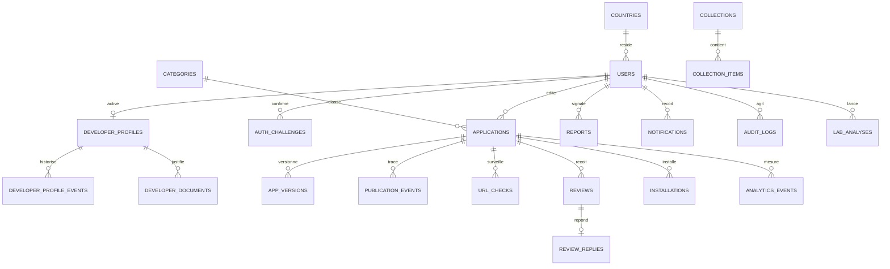
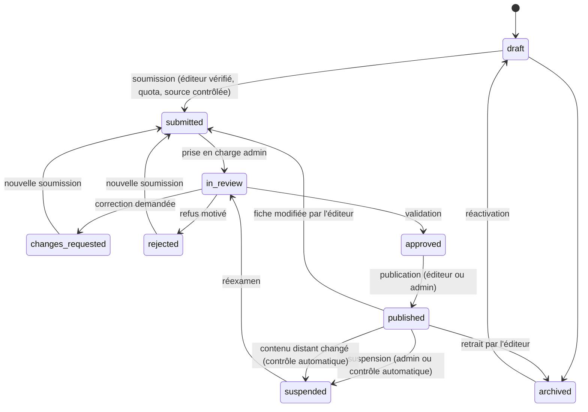

# PWA Store — Architecture cible

Ce document décrit l'architecture vers laquelle le code existant évolue, lot par lot. Il part de l'existant constaté dans `PWASTORE_AUDIT.md` et ne propose aucune réécriture.

## 1. Principes

1. **Un seul compte, une seule authentification** : Sanctum, jetons Bearer. Le profil développeur est un complément du compte (`developer_profiles.user_id` unique). Aucun second système d'auth.
2. **Deux validations distinctes** : la vérification de l'**éditeur** (profil + pièce d'identité) et la validation de chaque **application** et de chaque **version**. L'une n'entraîne jamais l'autre.
3. **Le serveur décide** : chaque règle (droits, quotas, transitions de statut) est appliquée côté Laravel. Le frontend affiche les capacités et les motifs de blocage renvoyés par l'API (`capabilities`, `publication_blockers`).
4. **Aucune donnée inventée** : statistiques mesurées uniquement ; l'installation est déclarative et présentée comme telle.
5. **Évolution additive** : migrations additives, sans suppression de colonne ni de donnée. Les anciens champs sont conservés et synchronisés tant qu'ils sont lus.
6. **Pas de promesse de sécurité** : la surveillance et les analyses réduisent des risques, elles ne les éliminent pas. Les textes de l'interface le disent.

## 2. Découpage en domaines

| Domaine        | Responsabilité                                                     | Modèles                                                                           |
| -------------- | ------------------------------------------------------------------ | --------------------------------------------------------------------------------- |
| Identité       | Compte, session, OTP, mot de passe, préférences, pays              | User, AuthChallenge, Country, PersonalAccessToken, UserPreference _(nouveau)_     |
| Éditeurs       | Profil développeur, vérification, justificatifs                    | DeveloperProfile, DeveloperProfileEvent, DeveloperDocument                        |
| Catalogue      | Applications, catégories, mise en avant, contenus éditoriaux       | Application, Category, Collection _(nouveau)_, CollectionItem _(nouveau)_         |
| Publication    | Sources (URL / build), versions, analyses, modération, déploiement | AppVersion, PublicationEvent _(modèle sur table existante)_, UrlCheck _(nouveau)_ |
| Communauté     | Avis, réponses, signalements                                       | Review, ReviewReply _(nouveau)_, Report _(nouveau)_                               |
| Usage          | Favoris, bibliothèque, installations, événements                   | Installation, InstallIntent, AnalyticsEvent, favorites                            |
| Notifications  | In-app et e-mail                                                   | table `notifications` Laravel _(nouveau)_                                         |
| Lab            | Diagnostics PWA à la demande                                       | LabAnalysis _(nouveau)_                                                           |
| Économie       | Quotas, plans, facturation (sans encaissement)                     | Plan _(nouveau)_, Invoice _(nouveau, désactivé)_                                  |
| Administration | Rôles, permissions, journal d'audit                                | AuditLog _(nouveau)_, colonne `users.status` _(nouveau)_                          |

## 3. Modèle de données cible

Les éléments **en gras** sont à créer ; le reste existe.

### Ajouts prévus

| Table / colonne                                            | Contenu                                                                           | Lot    |
| ---------------------------------------------------------- | --------------------------------------------------------------------------------- | ------ |
| `users.status`                                             | `active`, `suspended`, `deactivated` (défaut `active`)                            | 1 / 6  |
| `users.deactivated_at`, `users.anonymized_at`              | Désactivation puis anonymisation différée                                         | 1      |
| `password_reset_tokens`                                    | Existe, à utiliser via le broker Laravel                                          | 1      |
| `user_preferences`                                         | Langue, notifications par type et par canal, consentement « vus récemment »       | 7 / 10 |
| `applications.status` (valeurs)                            | Nouvelle machine à états, §4                                                      | 6      |
| `applications.published_at`, `archived_at`, `suspended_at` | Dates de cycle de vie                                                             | 6      |
| `applications.views_count`                                 | Compteur agrégé des vues de fiche                                                 | 8      |
| `url_checks`                                               | Historique des contrôles d'URL (statut HTTP, empreinte, manifeste, durée, erreur) | 4 / 9  |
| `review_replies`                                           | Réponse unique du développeur à un avis                                           | 7      |
| `reviews.status`, `reviews.hidden_reason`                  | `visible`, `hidden` (modération)                                                  | 7      |
| `reports`                                                  | Signalement polymorphe (application ou avis), motif, statut, traitement           | 7      |
| `collections`, `collection_items`                          | Sélections éditoriales ordonnées                                                  | 3 / 6  |
| `notifications`                                            | Table standard Laravel (`database` channel)                                       | 10     |
| `audit_logs`                                               | Acteur, action, cible polymorphe, avant/après, IP, date                           | 6      |
| `lab_analyses`                                             | URL, rapport JSON, score, auteur, date                                            | 9      |
| `plans`, `invoices`                                        | Structure de facturation, `payments_enabled = false`                              | 10     |

Aucune table existante n'est supprimée. `push_notifications` est conservée en lecture ; l'endpoint d'envoi simulé est désactivé (voir §6).

## 4. Machine à états des applications

Aujourd'hui : `draft → pending → approved | rejected | quarantined`. « Approuvée » vaut « publiée ».

Cible :

Correspondance pour la migration additive des données existantes :

| Ancien        | Nouveau                                     |
| ------------- | ------------------------------------------- |
| `draft`       | `draft`                                     |
| `pending`     | `submitted`                                 |
| `approved`    | `published` (l'app est visible aujourd'hui) |
| `rejected`    | `rejected`                                  |
| `quarantined` | `suspended`                                 |

Chaque transition passe par un seul service (`ApplicationLifecycle`) qui vérifie la transition autorisée, verrouille la ligne, écrit `publication_events` et déclenche la notification. Les versions gardent leur propre cycle (`moderation_status`, `scan_status`, `status`).

Visibilité publique : `status = published`, `is_active = true`, éditeur non suspendu, compte éditeur `active`. Une portée Eloquent unique (`Application::scopePubliclyVisible`) est utilisée par le catalogue, la fiche, `launch`, `install-intents` et la vitrine (corrige D4).

## 5. Rôles et permissions

Aujourd'hui : `users.role` (`user`, `developer`, `admin`) + capacités calculées dans `User::accountPayload()`.

Cible, sans paquet externe :

- `users.role` reste la source : `user`, `admin`. Le rôle `developer` devient historique : l'accès développeur dépend de l'existence du profil.
- Les administrateurs reçoivent des **permissions granulaires** stockées dans `users.admin_permissions` (JSON) : `developers.review`, `apps.moderate`, `reviews.moderate`, `reports.handle`, `catalog.manage`, `users.manage`, `settings.manage`, `audit.view`. Un admin sans liste explicite garde toutes les permissions (rétrocompatibilité).
- Implémentation (Lot 6) : `User::hasAdminPermission()` remplace les contrôles `role === 'admin'` des actions d'administration. Des Policies Laravel pourront regrouper ces règles plus tard ; le contrôle reste côté serveur dans tous les cas.
- Règles invariantes conservées : un admin ne revoit ni son propre profil, ni sa propre application, ni sa propre version.
- Les actions sensibles (suspension, refus, suppression de document, changement de permission) exigent un motif et écrivent `audit_logs`.

## 6. Sécurité

| Sujet                | Décision                                                                                                                                                                                                                                       |
| -------------------- | ---------------------------------------------------------------------------------------------------------------------------------------------------------------------------------------------------------------------------------------------- |
| Sessions             | Expiration des jetons Sanctum (30 jours glissants, configurable), liste et révocation des sessions dans « Sécurité du compte ». Le stockage `localStorage` est conservé à court terme ; la CSP du frontend limite le risque XSS.               |
| Connexion            | Throttle par IP (existant) et par compte (nouveau, verrou après 10 échecs / 15 min).                                                                                                                                                           |
| Mot de passe         | Broker Laravel, jeton à usage unique 60 min, réponse identique que l'e-mail existe ou non, révocation des jetons après réinitialisation.                                                                                                       |
| Analytics            | Événements limités aux apps publiées, throttle par compte et par appareil, déduplication par fenêtre de temps (corrige D2).                                                                                                                    |
| Push                 | Endpoint simulé désactivé (410) jusqu'à intégration réelle. Envoi futur réservé aux utilisateurs ayant installé l'app et consenti (corrige D1).                                                                                                |
| Avis                 | E-mail vérifié requis, un avis par compte et par app (existant), 2000 caractères max, throttle, statut de modération (corrige D5).                                                                                                             |
| Uploads              | Existant conservé : MIME + extension, taille, stockage privé, noms générés, `nosniff`. Ajouter un contrôle antivirus optionnel (ClamAV) si l'infrastructure le permet.                                                                         |
| SSRF                 | `ExternalPwaChecker` existant (résolution DNS épinglée, réseaux privés rejetés, redirections validées) réutilisé par PWA Lab.                                                                                                                  |
| Builds               | Jamais d'exécution de commandes de l'archive. Service depuis `pwa-{id}.<PWA_RUNTIME_DOMAIN>`, en-têtes de sécurité stricts, aucun cookie du Store sur ces origines.                                                                            |
| Données personnelles | Minimisation, purge des justificatifs, désactivation puis anonymisation des comptes, export des données sur demande. Référence : loi ivoirienne n° 2013-450 et RGPD pour les utilisateurs européens. Conformité à faire valider juridiquement. |

## 7. Notifications

- Canal `database` (in-app) + `mail`, via les Notifications Laravel, **mises en file** (`QUEUE_CONNECTION=database` existe déjà). Les OTP restent envoyés immédiatement.
- Préférences par type et par canal ; les notifications de sécurité (OTP, changement d'e-mail, mot de passe) ne sont pas désactivables.
- Regroupement : les avis reçus sont résumés au plus une fois par jour par e-mail.
- Événements : inscription, activation développeur, demande / décision de vérification, soumission, décision d'application ou de version, avis reçu, réponse à un avis, signalement traité, suspension, indisponibilité détectée, quota atteint.
- Frontend : cloche dans le layout, page « Notifications », compteur non lu.

## 8. Publication

**Méthode A — URL** : existant réutilisé. Ajouts : historique `url_checks`, contrôle de disponibilité plus fréquent (toutes les 6 h) avec alerte au développeur au 2e échec consécutif, suspension automatique au changement d'empreinte (existant : quarantaine).

**Méthode B — Build** : existant réutilisé (`PwaPackageAnalyzer`, versions, modération, déploiement, rollback). Prérequis d'infrastructure : `PWA_RUNTIME_DOMAIN`, DNS wildcard, certificat wildcard, vhost qui sert `storage/app/private/<runtime_path>` par sous-domaine. Tant que ce prérequis manque, l'interface indique que l'hébergement n'est pas disponible au lieu d'échouer.

## 9. Frontend

- **Structure** : conserver les trois layouts. Ajouter un `AdminLayout` quand le back-office dépasse trois pages.
- **Services** : regrouper les appels par domaine dans `src/services/` (`account.js` existe ; ajouter `catalog.js`, `developer.js`, `admin.js`, `notifications.js`) au lieu d'appels `api.*` dans les pages.
- **Stores** : `auth` existant ; ajouter `notifications` (compteur non lu) et `catalog` (catégories en cache).
- **Gros fichiers** : `StoreCatalogPage` (1768 lignes) et `EditAppPage` (1492) sont découpés en composants au moment où ils sont modifiés, pas en refonte isolée.
- **Responsive** : règle existante conservée, les fonctions développeur et admin n'apparaissent qu'à partir de 768 px.
- **Design** : Inter et Inter Tight auto-hébergées (`@fontsource`), GSAP + ScrollTrigger pour l'accueil, transitions Vue pour le reste, `prefers-reduced-motion` partout, skeletons sur toutes les listes.

## 10. Vitrine Blade

Recommandation : retirer la vitrine Blade (`routes/web.php`, `resources/views/apps`) une fois le frontend Quasar servi en production, et rediriger `/apps/{slug}` vers la fiche Quasar. Si le référencement naturel est prioritaire, envisager plutôt Quasar en mode SSR. Décision à confirmer (audit §7).
