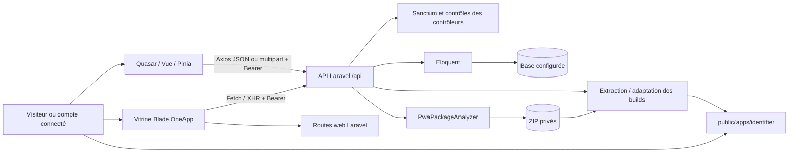

# TWA Store — TRD

> Audit du code accessible au 10 octobre 2026. **EXISTANT** : mécanisme constaté dans le code ; cela ne vaut pas recette en production. **PARTIEL** : chaîne incomplète ou incohérente. **ABSENT** : aucun mécanisme trouvé dans le périmètre examiné. **RECOMMANDÉ** : évolution proposée, non réalisée. **NON VÉRIFIÉ** : état inaccessible ou non testé.
>
> Références : **F:** = `/Users/apple/Documents/Quasar Projects/oneappapp/` ; **B:** = `/Users/apple/LaravelProjects/oneapp/`. Les chemins sont relatifs à ces racines. `Api/…Controller` désigne `B:app/Http/Controllers/Api/…Controller.php`. « TWA Store » est le nom demandé pour cette documentation ; le frontend affiche **PWA Store** et la vitrine Laravel **OneApp**. Aucun projet Android Trusted Web Activity n'a été identifié.

## Architecture observée

**EXISTANT.** Deux présentations, une API et un service de distribution local. L’accès statique à `public/apps` ne traverse pas automatiquement les autorisations Laravel. **NON VÉRIFIÉ.** Topologie de production, reverse proxy, base effective et quotas serveur. Le lien Valet observé relie `oneapp.test` à B ; il ne sert pas automatiquement les sources de F.

## Technologies et versions

Versions relevées dans les fichiers de verrouillage ; les contraintes ne doivent pas être confondues avec les versions effectivement verrouillées.

| Ensemble                | Contraintes / configuration | Version verrouillée ou observée         |
| ----------------------- | --------------------------- | --------------------------------------- |
| Vue                     | `^3.5.22`                   | 3.5.40                                  |
| Quasar                  | `^2.21.1`                   | 2.21.4                                  |
| Vue Router              | `^5.0.6`                    | 5.2.0                                   |
| Pinia / Axios           | package frontend            | 3.0.4 / 1.18.1                          |
| Quasar app-vite / Vite  | chaîne frontend             | 3.0.1 / 8.1.5                           |
| Node                    | `.nvmrc`                    | 24.14.1 ; version utilisée pour le lint |
| PHP / Laravel           | PHP `^8.3`, Laravel `^13.8` | CLI 8.5.7 / Laravel 13.20.0             |
| Sanctum                 | `^4.0`                      | 4.3.2                                   |
| PHPUnit                 | composer.lock               | 12.5.31                                 |
| Vite / Tailwind backend | package-lock backend        | 8.1.5 / 4.3.3                           |
| QRCode                  | dépendance backend          | 1.5.4                                   |
| PWA frontend            | workbox-build, GenerateSW   | 7.4.1 dans src-pwa/package-lock.json    |

Sources : F:package.json, package-lock.json, .nvmrc, src-pwa/package.json ; B:composer.json, composer.lock, package.json, package-lock.json. Aucun framework mobile natif ou packaging TWA Android n’est identifié. Les configurations de cibles Quasar additionnelles ne prouvent pas leur réalisation.

## Organisation des sources

| Périmètre | Répertoire/fichier                                          | Responsabilité                                                                      |
| --------- | ----------------------------------------------------------- | ----------------------------------------------------------------------------------- |
| F         | src/layouts                                                 | Main, Auth, Developer : cadres des parcours                                         |
| F         | src/pages/store, auth, developer, admin                     | Écrans métier                                                                       |
| F         | src/components/BrandLogo.vue, AppIcon.vue                   | Marque et gestion d’icône                                                           |
| F         | src/stores/auth.js                                          | Token, utilisateur, login/register/logout                                           |
| F         | src/boot/axios.js, pinia.js, theme.js                       | Services et initialisation                                                          |
| F         | src/router                                                  | Déclaration de routes, garde et titres                                              |
| F         | src/utils/media.js, src/composables                         | URL de médias, comportements partagés                                               |
| F         | src/css, public/brand, public/icons, src-pwa                | Thème et ressources PWA                                                             |
| B         | routes/api.php, web.php, console.php                        | API, vitrine, console                                                               |
| B         | app/Http/Controllers/Api                                    | Auth, fiches, versions, catégories, avis, bibliothèque, intentions, push, analytics |
| B         | app/Http/Controllers/StorefrontController.php               | Rendu Blade                                                                         |
| B         | app/Services/PwaPackageAnalyzer.php                         | Inspection et extraction ZIP                                                        |
| B         | app/Models, database/migrations                             | Modèles et schéma déclaré                                                           |
| B         | resources/views, resources/js/app.js, resources/css/app.css | Deuxième interface                                                                  |
| B         | public/oneapp-sw.js, public/oneapp-manifest.json            | PWA de la vitrine                                                                   |

Les pages IndexPage/SecondPage et certains composants Quasar de scaffold ne sont pas reliés aux parcours principaux. Aucune couche de jobs, policies, événements ou services externes métier complète n’a été trouvée.

## Frontend et communication

**EXISTANT.** Application JavaScript Vue, composants SFC, Pinia, Axios et routeur history. Les routes sont détaillées dans le document 03. Le catalogue reçoit un objet paginé, les autres endpoints renvoient souvent directement des modèles ou tableaux : il n’existe pas d’enveloppe API uniforme. Création et édition utilisent multipart ; l’édition `POST` avec `_method=PUT` est une substitution HTTP Laravel légitime, pas une route manquante.

`F:src/utils/media.js` utilise `import.meta.env.VITE_API_URL`, avec repli local `https://oneapp.test/api`. **PARTIEL.** La configuration installée de Quasar app-vite emploie le préfixe client `QCLI_` par défaut, sans surcharge identifiée dans quasar.config.js : l’injection de cette variable `VITE_` doit être confirmée lors d’un build de recette. L’URL effective de production est **NON VÉRIFIÉE**.

**RECOMMANDÉ.** Définir une seule convention d’environnement exposée au client et une validation au build. Décrire des contrats JSON stables, distinguer objets publics et objets de gestion, centraliser la gestion de pagination et les codes métier. Ne pas importer de secrets serveur dans le bundle.

## Authentification, tokens et autorisations

**EXISTANT.** Sanctum délivre des tokens après inscription ou connexion ; mot de passe haché, rôle limité user/developer à l’inscription. Déconnexion : suppression du token courant. Les routes protégées utilisent `auth:sanctum`, puis des conditions de rôle/propriété dans les contrôleurs. Le frontend cache les routes interdites à partir de son stockage local ; ce contrôle ne remplace pas le serveur.

**PARTIEL.** Quasar conserve `auth_token` et l’utilisateur dans localStorage ; Blade emploie `oneapp:token`. Le garde accepte la présence locale du token et n’appelle pas systématiquement `fetchUser`. Plusieurs JSON.parse ne sont pas protégés contre un stockage corrompu. Sur 401, Axios supprime le stockage et redirige mais ne synchronise pas complètement Pinia. « Rester connecté » ne modifie pas la persistance. Expiration Sanctum nulle dans la configuration par défaut, sans durée explicite à la création.

**RECOMMANDÉ.** Unifier la session cliente, réhydrater l’identité par `/auth/me`, traiter révocation/expiration sans état résiduel, décider d’une durée de token et d’un mécanisme de renouvellement. Évaluer une session cookie HttpOnly pour un frontend propriétaire après choix des origines et du modèle CSRF ; ce n’est pas la configuration actuelle. Le stockage de secrets de session dans localStorage accroît l’impact d’un XSS ([OWASP HTML5 Security](https://cheatsheetseries.owasp.org/cheatsheets/HTML5_Security_Cheat_Sheet.html)).

## Données et stockage

**EXISTANT.** Neuf modèles métier, 17 tables déclarées, relations Eloquent et clés étrangères détaillées dans le document 05. SQLite est le défaut configuré, pas la preuve du moteur actif. Cache, sessions et queue ont des pilotes database par défaut ; les variables d’environnement n’ont pas été lues.

**EXISTANT.** ZIP enregistrés sur le disque local privé sous `app_builds`. Hash SHA-256 et HMAC avec clé d’application enregistrés ; l’algorithme n’est ni un certificat éditeur ni une signature asymétrique. Les fichiers exécutables web sont extraits vers `public/apps/{identifier}`, puis certains chemins d’assets sont réécrits et du code d’installation injecté.

**PARTIEL.** Pas de contrôle observé du hash avant chaque extraction/téléchargement, pas de transaction atomique entre disque et base, suppression du runtime précédent avant remplacement. Le dossier de destination dépend d’un identifiant non contraint. Les captures reçues sous `media` n’ont pas de pipeline d’upload durable ; `icon_url` est une chaîne distante, non un upload vérifié. Les URL validées jusqu’à 2048 caractères sont stockées dans des colonnes string de taille par défaut : incohérence selon moteur SQL.

**RECOMMANDÉ.** Confinement canonique des chemins, répertoires immuables par version, bascule atomique, stockage média explicite, validation du type réel et nettoyage maîtrisé des fichiers orphelins. Pour les contenus non fiables, isolation d’origine et noms de stockage maîtrisés complètent les contrôles de taille et de type ([OWASP File Upload](https://cheatsheetseries.owasp.org/cheatsheets/File_Upload_Cheat_Sheet.html)).

## Analyse, services et automatisation

L’analyseur vérifie entrée index, manifeste, présence d’un worker, chemins dangereux, nombre d’entrées, taille décompressée et ratio de compression ; il repère certaines extensions et constructions JavaScript suspectes. Limites déclarées : 200 Mio décompressés, 10 000 fichiers, ratio 150. Les heuristiques ne constituent pas un antivirus ni une sandbox. La présence d’un service worker ne prouve pas le fonctionnement hors ligne. Les permissions dites détectées reprennent les permissions fournies.

**PARTIEL.** Une limite dépassée ajoute une erreur mais n’arrête pas nécessairement toutes les lectures ; certains contenus sont alloués avant application de leur limite d’analyse. L’extraction ne réapplique pas une politique complète de confinement et de ressources. La génération automatique des fichiers manquants ne garantit pas leur référencement correct dans le HTML.

**ABSENT.** Scan antivirus externe, vérification d’identité ou de domaine, sonde d’accessibilité distante, envoi push réel, paiement, tâches planifiées de nettoyage d’intentions et observabilité métier complète. Une infrastructure Laravel générique de queue n’implique pas des traitements asynchrones implémentés.

## Sécurité et erreurs

| Sujet                | Protection existante                                         | Limite / recommandation                                                                                        |
| -------------------- | ------------------------------------------------------------ | -------------------------------------------------------------------------------------------------------------- |
| Accès                | Sanctum et conditions de propriétaire/admin                  | Formaliser une politique commune sur chaque point d’entrée et les fichiers statiques                           |
| Entrées              | Validations Laravel et requêtes Eloquent paramétrées         | Contraindre identifiants/versions, éléments de tableaux, tailles de commentaires et payloads                   |
| ZIP                  | Détection d’entrées `..`, absolues et extensions dangereuses | Confiner aussi la destination ; arrêter tôt aux quotas ; isoler le runtime                                     |
| Transport navigateur | CSP frontend, CORS backend                                   | CSP incompatible avec certains médias/iframes ; CORS `*`, credentials false, à limiter selon origines retenues |
| HTML dynamique       | Échappements partiels                                        | Guide iOS interpolant le nom et icône injectée à examiner/corriger ; éviter innerHTML non maîtrisé             |
| Données publiques    | Mot de passe/remember_token masqués par User                 | Emails et détails de versions exposables via relations ; DTO publics à introduire                              |
| Authentification     | Hash du mot de passe et révocation courante                  | Aucun limiteur API applicatif explicite identifié ; politique d’expiration à fixer                             |
| Cache                | Workers et caches de shell                                   | Le worker Blade cache les GET authentifiés ; aucune séparation de compte ni purge privée observée              |

Sources : B:bootstrap/app.php, config/cors.php, config/sanctum.php, app/Models/User.php, contrôleurs, public/oneapp-sw.js ; F:index.html et AppDetailsPage.vue. Les constats et priorités R01–R12 sont regroupés dans la synthèse.

**EXISTANT.** Erreurs API rendues en JSON pour le préfixe api, validations 422, non-authentification 401, interdictions 403 et absences 404. **PARTIEL.** Codes de paquet incohérents avec la reprise frontend ; certains catches n’affichent qu’un log ou laissent continuer le parcours. Aucun identifiant corrélant une opération de publication à ses étapes n’est exposé uniformément.

## Journalisation, qualité et tests

Laravel dispose de la configuration de journalisation standard ; aucune plateforme de monitoring, alerte métier ou journal immuable de modération n’a été identifiée. Les métriques applicatives sont des événements déclaratifs, pas une surveillance de disponibilité.

**EXISTANT.** Lint frontend réussi lors de cet audit. Syntaxe PHP : 63 fichiers valides. PHPUnit Unit : 4 tests, 14 assertions réussies. Tests ciblés d’adaptation des assets et d’analyse ZIP, plus un test trivial. Dix tests Feature couvrent notamment accès d’extraction, vitrine et redirection historique, mais **n’ont pas été exécutés** pendant cet audit en raison de l’usage de RefreshDatabase. Aucun test frontend automatisé ni pipeline CI complet trouvé dans les fichiers examinés.

**RECOMMANDÉ.** Tests de contrat des écrans admin, matrice rôles/états, archive hostile, isolation d’origine, cache privé, persistance des médias, publication interrompue et parcours navigateur sur appareils. La recette DB devra se faire ultérieurement sur une base jetable explicitement autorisée ; aucune commande de migration ne doit être lancée au titre de cet audit.

## Environnements, déploiement et maintenance

**EXISTANT.** Quasar configure HTTPS local et history, boot pinia/axios/theme, PWA GenerateSW et manifeste autonome. La vitrine possède son propre manifeste et worker racine. Le backend expose `/up`. **NON VÉRIFIÉ.** Déploiement public, stratégie de routage SPA, workers de queue actifs, permissions disque, certificats, sauvegardes, rotation de secrets et restauration. Les scripts de setup Composer incluent des migrations ; ils n’ont pas été exécutés.

**RECOMMANDÉ.** Choisir les hôtes de l’interface, de l’API et des runtimes non fiables ; produire un build avec configuration contrôlée ; servir history avec repli SPA limité au frontend ; désactiver le debug public ; limiter tailles/durées ; publier en staging puis basculer après recette ; prévoir rollback fichiers/base compatible et backup restaurable. Les étapes de migration futures doivent être validées sur un environnement distinct.

Pour l’évolutivité, traiter d’abord la pagination et les agrégats N+1 du catalogue, les index adaptés aux filtres réellement mesurés, puis externaliser les paquets/médias et les analyses longues si les volumes le justifient. Extraire progressivement la distribution hors du contrôleur, sans réécrire les fonctions déjà opérationnelles. Les performances et capacités restent **NON VÉRIFIÉES** sans mesures représentatives.

## Responsabilités fonctionnelles du backend

Le backend ne se limite pas à la persistance du catalogue. Il fournit les services BF01–BF11 décrits dans le [PRD](./01_TWA_STORE_PRD.md#catalogue-fonctionnel-laravel-et-intégration-dans-quasar), ainsi que les routes de présentation Blade BF12 et leurs ressources PWA BF13.

| Groupe de services EXISTANT | Entrée / sortie principale                                                    | Frontière à préserver                                                                           |
| --------------------------- | ----------------------------------------------------------------------------- | ----------------------------------------------------------------------------------------------- |
| Comptes et permissions      | Identifiants → User/token ; rôle et propriété → décision d’accès              | Le serveur autorise ; le garde Quasar ne remplace pas cette décision                            |
| Catalogue et référentiel    | Filtres → pagination ; catégories → ordre/présentation/compteurs              | Réutiliser les données et tris serveur, éviter les référentiels clients divergents              |
| Publication et distribution | Métadonnées/ZIP → fiche/version/rapport ; version → runtime ou ZIP            | Publication, approbation et ouverture sont des opérations distinctes                            |
| Bibliothèque et appareils   | Installation déclarée → entrée personnelle ; PATCH → état/archivage/ouverture | Le serveur conserve la déclaration ; il ne commande pas une désinstallation navigateur          |
| Reprise et mises à jour     | Intention → token/URL ; installations → latest_version                        | Ni l’intention ni la version différente ne prouvent une installation réussie                    |
| Avis et analytics           | Note/événement → enregistrement ; application → synthèse                      | Un avis utilisateur, un événement déclaratif et une mesure fiable ont des garanties différentes |
| Notification                | Destinataire/message → ligne avec passerelle simulée                          | Livraison réelle absente : aucun fournisseur appelé                                             |

**RECOMMANDÉ.** Les nouvelles pages Quasar doivent appeler ces contrats existants et présenter leurs erreurs/états réels. Les opérations non raccordées ne nécessitent pas par défaut un nouveau backend. Pour les contrats exacts, types, permissions et réponses, utiliser le [document 05](./05_TWA_STORE_BACKEND_SCHEMA.md#contrats-api--routes-déclarées). Les limites de sécurité et d’intégrité recensées restent à corriger avant raccordement public.

## Documents associés

[00](./00_TWA_STORE_AUDIT_SUMMARY.md) · [01](./01_TWA_STORE_PRD.md) · [02](./02_TWA_STORE_TRD.md) · [03](./03_TWA_STORE_APP_FLOW.md) · [04](./04_TWA_STORE_UX_UI.md) · [05](./05_TWA_STORE_BACKEND_SCHEMA.md) · [06](./06_TWA_STORE_IMPLEMENTATION_PLAN.md)

## Contrats livrés : OTP, Country et espace adapté (11 octobre 2026)

### Authentification

- `POST /api/auth/register` exige `name`, `email`, `password`, `password_confirmation`, `country_id`. Le choix facultatif `two_factor_enabled` active la double authentification à la connexion ; seul le canal `email` est accepté. La réponse 201 contient une demande OTP, **aucun jeton de session**.
- `POST /api/auth/login` vérifie le mot de passe côté serveur, sans ouvrir de session Web intermédiaire. Compte non confirmé : demande `verify_email`. Compte confirmé avec double authentification : demande `login` (202). Compte confirmé sans double authentification : session habituelle (200). Un indicateur client ne peut pas désactiver le réglage enregistré.
- `POST /api/auth/otp/verify` reçoit `challenge_id` et `code` (chaîne de six chiffres). Après validation finale uniquement, il retourne `access_token`, `token_type` et `user`. Code incorrect, expiré, épuisé ou déjà consommé : 422 sans jeton. Le renvoi se fait par `POST /api/auth/otp/resend` ; un renvoi trop rapide reçoit 429.
- Une demande contient `requires_otp`, `challenge_id`, `purpose`, `channel`, `destination` masquée, `expires_at`, `retry_after`, `code_sent` et `message`. Une indisponibilité d’envoi conserve une demande réessayable et ne donne pas accès au compte.
- `POST /api/account/two-factor` est authentifié et exige `enabled`, `channel=email`, `current_password`. Le réglage ne change qu’après confirmation par code. Les anciennes sessions sont alors révoquées et la session courante est remplacée. SMS et WhatsApp sont désactivés dans l’interface et refusés côté serveur.
- `PUT /api/account` modifie le nom et le pays. Un changement d’e-mail exige le mot de passe et confirme la nouvelle adresse avant remplacement. Si la double authentification est active, un premier code envoyé à l’ancienne adresse autorise ce changement, puis un second confirme la nouvelle. La validation finale révoque les anciens jetons.

Le frontend conserve uniquement la demande en cours dans `sessionStorage` et ne stocke pas de code OTP. `/verify-email` gère confirmation, erreur, renvoi, poursuite d’un changement d’adresse et reprise après rechargement. La vitrine Blade existante prend également en charge une réponse de connexion demandant un code.

### Pays, activité et bibliothèque

| Endpoint                           | Accès                       | Contrat principal                                                                                                                                   |
| ---------------------------------- | --------------------------- | --------------------------------------------------------------------------------------------------------------------------------------------------- |
| `GET /api/countries`               | Public                      | Liste des pays actifs : `id`, `code`, `name`, `name_en`.                                                                                            |
| `GET /api/admin/countries/summary` | Administrateur              | Comptes par pays de résidence, profils développeurs par pays légal, nombre de pays de résidence non renseignés. Aucun pays inféré depuis une IP.    |
| `GET /api/developer/dashboard`     | Espace développeur autorisé | Activité du seul éditeur courant : applications par statut, versions, installations déclarées, ouvertures enregistrées, quotas et éléments récents. |
| `GET /api/library?device_uuid=...` | Utilisateur authentifié     | Installations et téléchargements enregistrés pour ce compte et cet identifiant de navigateur.                                                       |
| `POST /api/installations`          | Utilisateur authentifié     | Build approuvé ou PWA externe approuvée ; distinction entre `downloaded` et `installed`.                                                            |
| `PATCH /api/installations/{id}`    | Propriétaire de l’entrée    | Mise à jour de l’état déclaré, notamment désinstallation.                                                                                           |

### Règle d’affichage de Mon espace

À partir de 768 px, un compte disposant d’un profil développeur (ou d’un rôle développeur historique) voit le tableau de bord de publication, avec accès à ses applications, sa vérification et ses quotas. Il garde accès à sa bibliothèque personnelle, ses favoris et ses réglages. Un compte utilisateur ordinaire voit sa bibliothèque.

En dessous de 768 px, tous les comptes développeurs voient l’espace utilisateur : aucun appel au tableau de bord développeur, aucun bouton de publication, aucune entrée développeur dans les menus. Une navigation directe vers `/developer...`, ou un passage à la vue mobile depuis ces routes, ramène vers `/account`. Les droits serveur du compte ne sont pas modifiés par la taille de l’écran.

### SMTP et portée de la validation

Le SMTP fourni est enregistré uniquement dans le `.env` privé, exclu de Git. Le transport utilise le port 587 avec STARTTLS obligatoire ; la vérification TLS n’est pas désactivée. Le nom d’expéditeur reste `${APP_NAME}`, avec `APP_NAME=PWA Store`.

La connexion et l’authentification SMTP ont été vérifiées avec succès, sans message de test envoyé. Les tests fonctionnels interceptent les e-mails en mémoire ; ils valident les parcours et les codes, mais ne prouvent pas la réception en boîte de réception ou le classement antispam. Le scheduler doit rester actif pour purger les demandes OTP expirées.
