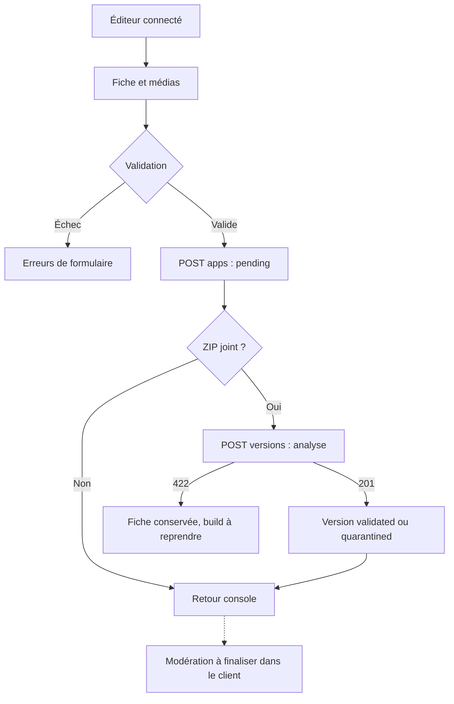
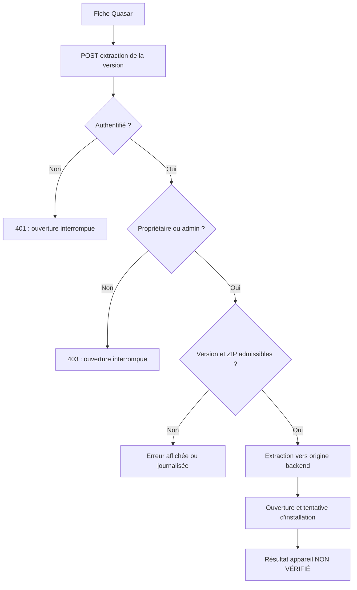
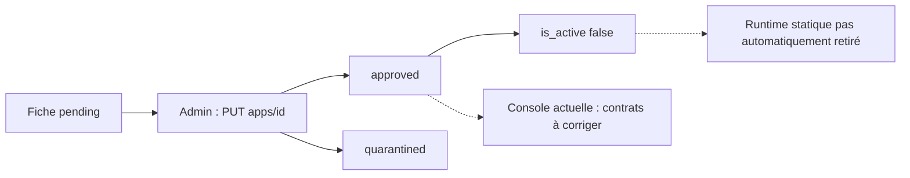

# TWA Store — Parcours utilisateur

> Audit du code accessible au 10 octobre 2026. **EXISTANT** : mécanisme constaté dans le code ; cela ne vaut pas recette en production. **PARTIEL** : chaîne incomplète ou incohérente. **ABSENT** : aucun mécanisme trouvé dans le périmètre examiné. **RECOMMANDÉ** : évolution proposée, non réalisée. **NON VÉRIFIÉ** : état inaccessible ou non testé.
>
> Références : **F:** = `/Users/apple/Documents/Quasar Projects/oneappapp/` ; **B:** = `/Users/apple/LaravelProjects/oneapp/`. Les chemins sont relatifs à ces racines. `Api/…Controller` désigne `B:app/Http/Controllers/Api/…Controller.php`. « TWA Store » est le nom demandé pour cette documentation ; le frontend affiche **PWA Store** et la vitrine Laravel **OneApp**. Aucun projet Android Trusted Web Activity n'a été identifié.

## Carte des écrans et conventions

Dans les tableaux, les API sont préfixées par `/api`. Une page présente dans le routeur n’implique pas que toutes ses actions aboutissent.

| Route frontend Quasar                   | Layout / écran                         | Accès déclaré                               |
| --------------------------------------- | -------------------------------------- | ------------------------------------------- |
| `/`                                     | MainLayout / StoreCatalogPage          | Public                                      |
| `/recommended`, `/trending`, `/popular` | MainLayout / AppListPage               | Public                                      |
| `/apps/:id`                             | MainLayout / AppDetailsPage            | Public ; visibilité serveur selon statut    |
| `/login`, `/register`                   | AuthLayout / pages auth                | Invité ; redirection si token local présent |
| `/developer`                            | DeveloperLayout / DeveloperConsolePage | Authentifié developer ou admin              |
| `/developer/apps/create`                | DeveloperLayout / CreateAppPage        | Authentifié developer ou admin              |
| `/developer/apps/:id/edit`              | DeveloperLayout / EditAppPage          | Rôle côté route ; propriété côté API        |
| `/admin`                                | MainLayout / AdminConsolePage          | Admin                                       |
| Route inconnue                          | ErrorNotFound                          | Public                                      |

Sources : F:src/router/routes.js et index.js. Pas de route utilisateur bibliothèque/profil, récupération de mot de passe, facturation ou vérification d’éditeur dans Quasar.

| Route web Laravel                              | Écran / comportement                               | Accès                                            |
| ---------------------------------------------- | -------------------------------------------------- | ------------------------------------------------ |
| `/`                                            | apps/index.blade.php                               | Public ; sélection serveur des fiches approuvées |
| `/apps/{slug}`                                 | apps/show.blade.php ; recherche slug ou identifier | Public ; fiche approuvée                         |
| `/library`                                     | apps/library.blade.php                             | Shell public ; données chargées avec token       |
| `/developer/apps/create`, `/developer/publish` | apps/publish.blade.php                             | Shell public avec connexion ; API protégée       |
| Chemin historique Pharma                       | Redirection vers l’identifiant corrigé             | Public, gardes contre chemins suspects           |
| `/up`                                          | Santé Laravel                                      | Public                                           |

Sources : B:routes/web.php, StorefrontController, resources/views/apps. Le backend peut également servir les fichiers déployés sous `/apps/{identifier}/…` sans passer par la fiche Blade.

## 1. Visiteur, catalogue, recherche et filtres — EXISTANT / PARTIEL

**Départ et écrans.** Accueil Quasar ou listes thématiques, puis fiche. **Étapes/actions.** Chargement du catalogue ; saisie dans le header ; suggestions dès deux caractères ; clic sur suggestion ou soumission vers `/?search=…` ; filtres catégorie/prix/plateforme et tri selon page ; clic de carte.

**API.** `GET /apps` avec recherche/filtres/tri ; `GET /apps/suggestions` ; `GET /categories`. **Validation/accès.** Public ; index serveur limité à approved et is_active ; suggestions limitées par préfixe mais sans contrôle is_active. **Erreurs.** Réseau, catalogue vide, référentiel de catégories indisponible ; catégories de secours présentes sur la liste. **Résultat.** Affichage de la première page de résultats, puis navigation par ID.

**Incomplet.** Pagination de 12 résultats non exposée ; historique local de cinq recherches, non synchronisé serveur ; suggestions sans annulation de requêtes ; quelques classements et contenus de démonstration peuvent donner une impression erronée. Blade recherche uniquement parmi les cartes déjà rendues, pas dans tout le catalogue.

Sources : F:src/layouts/MainLayout.vue, StoreCatalogPage.vue, AppListPage.vue ; B:ApplicationController::index/suggestions, StorefrontController::index, resources/js/app.js.

## 2. Inscription — EXISTANT

**Départ.** `/register`, AuthLayout. **Étapes.** Nom, email, mot de passe et confirmation, choix user/developer ; soumission ; stockage du token et du compte ; redirection vers `/`. **API.** `POST /auth/register`. **Validation.** Email valide/unique, mot de passe confirmé d’au moins huit caractères, rôle parmi les deux autorisés. **Accès.** Invité côté route. **Erreurs.** 422 de validation, réseau ; pas d’attribution admin par ce formulaire. **Résultat.** Compte créé et authentifié.

**ABSENT.** Confirmation d’email, vérification d’identité d’éditeur et acceptation légale traçable structurée non identifiées. Les éventuelles cases/mentions visuelles ne prouvent pas un enregistrement de consentement.

Sources : F:src/pages/auth/RegisterPage.vue, src/stores/auth.js ; B:AuthController::register.

## 3. Connexion, session et déconnexion — EXISTANT / PARTIEL

**Départ.** `/login` ou demande de connexion Blade. **Étapes.** Email et mot de passe ; appel login ; token sauvegardé ; redirection accueil Quasar ou rechargement Blade. Déconnexion Quasar via menu ; révocation du token courant. **API.** `POST /auth/login`, `POST /auth/logout` ; `/auth/me` existe mais sa réhydratation n’est pas branchée au démarrage constaté. **Validation.** Champs requis et authentification serveur. **Erreurs.** 401 mauvais identifiants ou token invalide, 422 champs, réseau. **Résultat.** Navigation selon rôle local puis autorisation réelle par API.

**Incomplet.** « Rester connecté » sans effet ; destination initiale non restaurée ; token expiré encore accepté par le garde jusqu’à une réponse serveur ; 401 ne purge pas tout Pinia ; localStorage corrompu peut faire échouer JSON.parse. Les clés Blade et Quasar diffèrent : pas de connexion partagée garantie.

Sources : F:src/pages/auth/LoginPage.vue, src/stores/auth.js, src/boot/axios.js, src/router/index.js ; B:AuthController et resources/js/app.js.

## 4. Récupération du mot de passe — ABSENT

**Départ.** Bouton « mot de passe oublié » du login. **Étapes/API/validation.** Aucun flux raccordé identifié. La table password_reset_tokens et le mailer Laravel configuré ne suffisent pas. **Accès.** Lien visible. **Erreur/résultat.** Aucune récupération opérationnelle démontrée. **RECOMMANDÉ.** Définir une demande neutre, un lien expirant et un écran de renouvellement, avec tests d’abus et d’expiration.

## 5. Espace personnel et bibliothèque — PARTIEL

**Départ.** « Mon espace » Quasar ou `/library` Blade. **Écrans.** Quasar envoie vers `/developer`, auquel le rôle user n’a pas accès ; Blade possède une bibliothèque. **API.** `GET /library`, `GET /library/updates` ; le backend propose `POST /installations` et `PATCH /installations/{id}`. **Validation.** Compte requis pour les données ; installation attachée à l’utilisateur ; version de la bonne application, validée ou active. **Erreurs.** 401/403, 404 de version, bibliothèque vide. **Résultat.** Lecture de données existantes possible ; remplissage automatique depuis une installation réelle non raccordé dans les clients examinés.

**Incomplet.** Le calcul des mises à jour écrit en base pendant un GET et compare des identifiants différents, sans garantir une version strictement plus récente. Pas de gestion utilisateur complète de profil, suppression de compte ou préférences observée.

Sources : F:src/layouts/MainLayout.vue ; B:InstallationController, resources/views/apps/library.blade.php, resources/js/app.js.

## 6. Soumission Quasar — PARTIEL

**Départ.** Console développeur → création. **Écran.** Assistant en cinq étapes : Identité, Média & liens, Captures d’écran, Compatibilité, Premier build. **Actions.** Choisir catégorie, renseigner nom/identifiant/descriptions/liens, ajouter captures mobile/tablette, sélectionner compatibilités et éventuellement ZIP/version.

**API.** `GET /categories`, puis `POST /apps` multipart ; si ZIP présent, second `POST /versions`. **Validation.** Frontend : identité renseignée, catégorie et capture mobile, numéro de version si ZIP ; backend : limites de champs, unicité d’identifiant, formats image pour captures à la création, fichier ZIP et analyse. **Accès.** Developer/admin ; le serveur lie developer_id au compte. **Erreurs.** 422 métadonnées/ZIP, 403 rôle, erreur réseau ; fichier invalide refusé, fichier suspect éventuellement accepté en quarantaine. **Résultat.** Fiche pending ; version éventuelle enregistrée. Si le ZIP échoue, la fiche déjà créée demeure et un avertissement est affiché.

**Incomplet.** Captures non stockées durablement côté serveur ; formulaire et données conservées après échec à clarifier ; la soumission n’équivaut ni à approbation ni à déploiement. `trust_score=100` initial ne garantit aucune revue.

Sources : F:src/pages/developer/CreateAppPage.vue ; B:ApplicationController::store, AppVersionController::store, PwaPackageAnalyzer.

## 7. Publication Blade — PARTIEL

**Départ.** `/developer/publish` ou `/developer/apps/create` côté Laravel. **Étapes.** Connexion si nécessaire, formulaire avec catégories intégrées, brouillon local sans les fichiers, preview, POST fiche puis XHR ZIP avec progression. **API.** Login, `POST /apps`, `POST /versions`. **Validation.** Identifiant contraint dans ce formulaire, description et ZIP requis ici ; l’API reste l’autorité et accepte un autre client. **Accès.** Shell public, création réservée developer/admin. **Erreurs.** Identifiant déjà pris, upload/scan rejeté, absence de token. **Résultat.** Fiche et version reçues, sans déploiement automatique constaté.

**Incomplet.** Les étapes de progression anticipent certaines phases de vérification ; une reprise intégrale après échec du ZIP peut tenter de recréer la fiche et se heurter à l’unicité. Brouillon local et capture Quasar ne sont pas synchronisés.

Sources : B:resources/views/apps/publish.blade.php, resources/js/app.js.

## 8. Modification, version et désactivation — PARTIEL

**Départ.** `/developer` → fiche → édition. **Étapes.** `GET /developer/apps` ; chargement catégories/fiche ; édition ; sauvegarde multipart `POST /apps/{id}` avec `_method=PUT` ; éventuelle nouvelle version. **Validations.** Propriété/admin côté serveur ; types/champs validés ; version et ZIP inspectés. **Actions.** Métadonnées, médias, compatibilité, activation, upload ; suppression visible seulement à l’admin. **Erreurs.** 403 propriétaire différent, 422, 404, réseau. **Résultat.** Métadonnées mises à jour et version éventuelle ajoutée.

**Incomplet.** `saveMetaDataOnly` absorbe une erreur et `saveAll` poursuit ; les captures supprimées dans l’UI n’ont pas de protocole serveur de suppression ; décocher toutes les compatibilités peut ne rien envoyer et conserver l’ancien état. La console attend un code d’erreur ZIP différent du serveur. Désactiver n’enlève pas les fichiers runtime publics.

Sources : F:src/pages/developer/EditAppPage.vue, DeveloperConsolePage.vue ; B:ApplicationController::update/destroy, AppVersionController.

## 9. Fiche et avis — EXISTANT / PARTIEL

**Départ.** Carte → `/apps/:id`. **Étapes.** GET fiche et relations, lecture de description/version/avis, sélection note et commentaire, envoi puis rechargement. **API.** `GET /apps/{id}`, `POST /reviews`. **Validation.** Avis authentifié, application approved, note 1–5 ; commentaire facultatif. Avis existant du même utilisateur modifié. **Erreurs.** 404 fiche, 401 pour avis, 422 note, réseau ; certaines erreurs seulement en console. **Résultat.** Fiche affichée, avis créé ou mis à jour.

**Incomplet.** Captures Unsplash choisies par ID dans Quasar au lieu des médias soumis, dernière version basée sur date sans filtre d’état, valeur zéro parfois rendue comme 5.0. Le serveur ne possède pas de contrainte unique sur le couple auteur/application des avis.

## 10. Ouvrir et installer une PWA — PARTIEL

**Départ.** Bouton de la fiche Quasar. **Étapes actuelles.** Prend `versions[0]` ; `POST /versions/{id}/extract` ; en cas de succès calcule l’URL backend `/apps/{identifier}/index.html` et l’ouvre ; iframe cachée et messages participent à l’aide d’installation. **Accès réel.** Extraction propriétaire/admin et état de version admissible. **Erreurs.** Visiteur 401, utilisateur ordinaire 403, ZIP absent 404, version refusée 409 ; blocage d’iframe par CSP ; événement d’origine non concordante ; installation refusée ou navigateur incompatible. **Résultat.** Parcours possible pour certains propriétaires, pas d’installation publique fiable démontrée.

**Points incomplets.** Ouverture d’une fenêtre après attente réseau susceptible de rencontrer le bloqueur de fenêtres ; réception de message compare à l’origine Quasar plutôt qu’à l’émetteur backend ; pas de sandbox sur iframe ; émission `*` ; succès utilisateur insuffisamment distingué de l’annulation. Aucune écriture d’installation confirmée à l’API depuis ce parcours.

La fiche Blade propose ouverture, QR, partage/copie, guides spécifiques et intention d’installation. L’API crée un token d’intention de 30 minutes, mais la reprise complète par lecture/consommation n’est pas raccordée au client. Le bouton manuel « J’ai terminé » n’est pas une preuve technique d’installation.

Sources : F:src/pages/store/AppDetailsPage.vue, index.html ; B:AppVersionController, InstallIntentController, resources/js/app.js et apps/show.blade.php.

**RECOMMANDÉ — parcours cible distinct.** La publication se fait côté éditeur/admin, puis le visiteur ouvre un runtime déjà autorisé et isolé. La demande d’installation suit les capacités réelles du navigateur et ne marque l’installation qu’avec un signal explicite ou un état « déclaré par l’utilisateur » distinct.

## 11. Installer le store lui-même — EXISTANT / NON VÉRIFIÉ

Quasar écoute `beforeinstallprompt` et `appinstalled`, propose l’installation du store et dispose d’un manifeste/worker. Blade dispose d’un autre manifeste et worker. Ce parcours installe le catalogue, pas nécessairement les applications référencées. Prérequis navigateur, HTTPS et contrôle de l’installabilité restent à recetter sur appareils. Sources : F:src/layouts/MainLayout.vue, src-pwa ; B:public/oneapp-sw.js, public/oneapp-manifest.json, resources/js/app.js.

## 12. Modération et retrait — PARTIEL

**Départ.** `/admin`. **Étapes.** `GET /admin/apps` ; sélectionner application ; consulter statistiques ; changer statut ou score ; éventuellement supprimer. **Accès.** Admin au garde et à l’API. **API réellement disponibles.** `PUT /apps/{id}` avec status/trust_score ; `GET /analytics/summary/{app_id}` ; `DELETE /apps/{id}`. **Erreur actuelle.** Le client appelle trois routes différentes, donc 404/405 selon résolution serveur ; le champ attendu de crash diffère. **Résultat.** Liste accessible, décisions et statistiques non fiables via ces boutons.

**Désactivation propriétaire.** `PUT /apps/{id}` avec is_active, sans retrait statique garanti. **Suppression admin.** Supprime ZIP, dossier runtime puis enregistrement avec cascades ; cohérence en cas d’échec partiel non transactionnelle. **RECOMMANDÉ.** Décision motivée, confirmation adaptée, retrait effectif et traçabilité avant lancement.

## 13. Vérification d’éditeur, contributions et abonnements — ABSENT

Aucun écran, endpoint, entité métier ou validation dédiée trouvé. Point de départ et résultat opérationnels : non disponibles. Les rôles, champs d’URL, prix et score ne doivent pas être présentés comme ces parcours. **RECOMMANDÉ.** Décisions de produit puis spécification séparée ; ne pas ajouter des écrans factices donnant l’impression d’un service actif.

## 14. Catégories, push et analytics — API EXISTANTE, parcours client PARTIEL

L’admin peut gérer les catégories via API, sans écran Quasar de gestion identifié. Le propriétaire/admin peut demander une notification : elle est seulement stockée avec statut simulé. Tout compte authentifié peut déclarer un événement d’usage pour une application existante ; propriétaire/admin peut lire les agrégats. Ces points d’entrée sont documentés dans le document 05 et ne constituent pas des parcours utilisateur final complets.

## 15. Parcours des capacités Laravel non complètement exposées dans Quasar

Ces parcours décrivent des **opérations API existantes**, pas des écrans Quasar déjà réalisés. Toutes les URL API sont préfixées par `/api`. Sources : B:routes/api.php et contrôleurs indiqués ; correspondance BF dans le PRD.

| Capacité / départ et écran                                                                  | Étapes et API                                                                                        | Accès et validations                                                                                      | Erreurs et résultat réel                                                                                                                                |
| ------------------------------------------------------------------------------------------- | ---------------------------------------------------------------------------------------------------- | --------------------------------------------------------------------------------------------------------- | ------------------------------------------------------------------------------------------------------------------------------------------------------- |
| BF04 — administrer les catégories ; écran Quasar ABSENT                                     | GET categories?all=1 ; POST categories ; PUT categories/id ; DELETE categories/id                    | Mutations admin ; nom unique ≤255, booléen is_active, order entier, description/icône/couleur facultatifs | 401/403/404/422 ; catégorie créée/modifiée/supprimée. Suppression conserve les fiches et met leur category_id à null ; collision de slug à gérer        |
| BF07 — retrouver ses applications ; bibliothèque Blade existante, Quasar ABSENTE            | GET library renvoie les entrées non archivées, application et version, triées par dernière ouverture | Compte authentifié ; filtrage par user_id                                                                 | 401/réseau ou liste vide ; lecture des installations enregistrées, sans découverte automatique des PWA du navigateur                                    |
| BF08 — enregistrer une installation ; raccordement client PARTIEL                           | POST installations avec application/version/device_uuid/platform ; entrée créée ou actualisée        | Compte ; version de l’application en état validated/active ; plateforme autorisée                         | 401/404/422 ; réponse 201, compteur incrémenté seulement pour une nouvelle combinaison, même si état failed : limite métier à corriger                  |
| BF08 — ouvrir, archiver ou déclarer une désinstallation ; écran de gestion Quasar ABSENT    | PATCH installations/id : opened=true, archived=true/false ou status                                  | Propriétaire de l’installation ; booléens et statuts validés                                              | 403 autre compte ; horodatage/archivage/état changés en base. status=uninstalled n’enlève pas l’application du système                                  |
| BF07 — consulter les mises à jour ; bibliothèque Blade partiellement raccordée              | GET library/updates ; liste de couples installation/latest_version                                   | Compte ; installations installed ; versions validated/active triées par version_code puis ID              | 401/réseau ; une version différente est proposée. Le GET modifie update_available ; comparaison stricte de progression à corriger                       |
| BF09 — préparer et reprendre une action ; création Blade présente, reprise complète ABSENTE | POST install-intents avec application_id/action/payload ; puis GET install-intents/token             | Création publique, fiche approved ; compte facultatif ; token valable 30 minutes, non consommé            | 404 expiré/consommé ; lecture marque consumed_at. Pas de vérification d’installation ni de consommation atomique garantie                               |
| BF05 — télécharger un paquet ; parcours Quasar dédié ABSENT                                 | GET versions/id/download                                                                             | Fiche approved pour public ; sinon propriétaire/admin ; présence ZIP                                      | 403/404 ; flux de téléchargement ZIP. Ce téléchargement n’installe pas une PWA et n’enregistre pas une installation                                     |
| BF11 — mesurer une utilisation ; instrumentation Quasar PARTIELLE                           | POST analytics/events avec application_id, event_type, device_platform et options                    | Tout compte authentifié ; événement open/close/crash/error ; application existante                        | 401/422 ; événement enregistré 201, sans preuve qu’une exécution réelle a eu lieu                                                                       |
| BF11 — lire une synthèse ; écran admin présent mais contrat incorrect                       | GET analytics/summary/app_id                                                                         | Propriétaire de la fiche ou admin                                                                         | 403/404 ; totaux, plateformes, ratio de crashes et cinq modèles d’appareils les plus représentés. Absence d’événements ne prouve pas absence de crashes |
| BF10 — demander un push ; écran Quasar ABSENT                                               | POST push-notifications avec application/user/title/body                                             | Propriétaire de la fiche ou admin ; cible existante ; titre ≤255                                          | 401/403/422 ; notification conservée et marquée sent par simulation. Aucun message réellement livré par ce contrôleur                                   |

**RECOMMANDÉ — raccordement.** Réutiliser les opérations bibliothèque/installations pour l’espace utilisateur, les catégories pour l’administration et analytics pour les statistiques. Conserver les contrôles serveur. Traiter les états vide/erreur/annulation, distinguer une déclaration manuelle d’une confirmation navigateur et ne pas appeler plusieurs fois les mutations pour simuler un succès.

## Documents associés

[00](./00_TWA_STORE_AUDIT_SUMMARY.md) · [01](./01_TWA_STORE_PRD.md) · [02](./02_TWA_STORE_TRD.md) · [03](./03_TWA_STORE_APP_FLOW.md) · [04](./04_TWA_STORE_UX_UI.md) · [05](./05_TWA_STORE_BACKEND_SCHEMA.md) · [06](./06_TWA_STORE_IMPLEMENTATION_PLAN.md)
