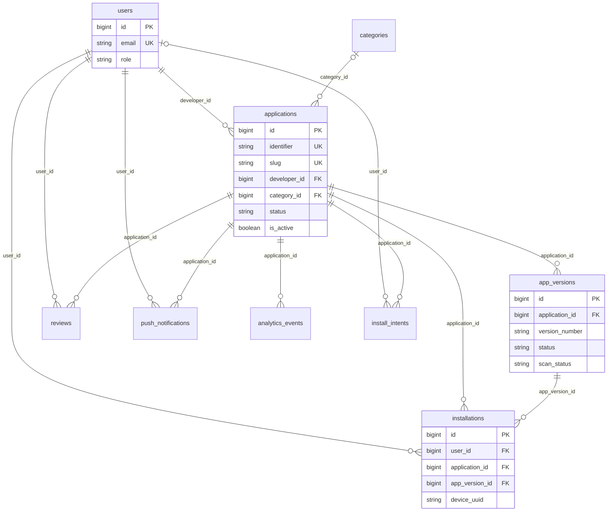
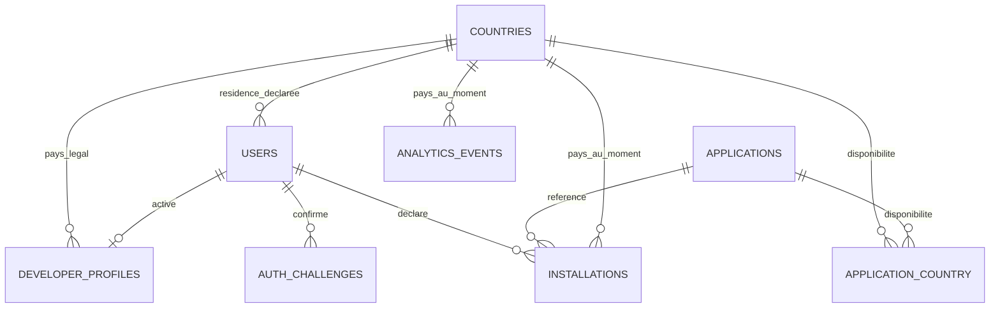

# TWA Store — Backend, schéma et contrats API

> Audit du code accessible au 10 octobre 2026. **EXISTANT** : mécanisme constaté dans le code ; cela ne vaut pas recette en production. **PARTIEL** : chaîne incomplète ou incohérente. **ABSENT** : aucun mécanisme trouvé dans le périmètre examiné. **RECOMMANDÉ** : évolution proposée, non réalisée. **NON VÉRIFIÉ** : état inaccessible ou non testé.
>
> Références : **F:** = `/Users/apple/Documents/Quasar Projects/oneappapp/` ; **B:** = `/Users/apple/LaravelProjects/oneapp/`. Les chemins sont relatifs à ces racines. `Api/…Controller` désigne `B:app/Http/Controllers/Api/…Controller.php`. « TWA Store » est le nom demandé pour cette documentation ; le frontend affiche **PWA Store** et la vitrine Laravel **OneApp**. Aucun projet Android Trusted Web Activity n'a été identifié.

## Portée du schéma et conventions

**EXISTANT dans les sources :** 17 tables définies dans 16 migrations. **NON VÉRIFIÉ :** application effective de ces migrations, moteur SQL actif, index physiques et contenu de la base. Aucun accès SQL ni migration n’a été exécuté. Les types ci-dessous sont les types logiques Laravel ; leur représentation physique dépend du moteur.

`string` sans longueur explicite signifie 255 par défaut ; `id` est un entier large non signé auto-incrémenté, clé primaire. `foreignId` est un entier large non signé. `timestamps` ajoute created_at et updated_at nullable. Les commentaires d’état ne sont pas des contraintes CHECK ou ENUM en base. Les colonnes non notées nullable sont obligatoires au schéma, sauf comportement propre du moteur. Aucun secret ni exemple de token réel n’est reproduit.

## Inventaire des migrations

Tous les chemins ci-dessous sont dans B:database/migrations.

| Fichier                                                     | Effet de up() constaté                                                            |
| ----------------------------------------------------------- | --------------------------------------------------------------------------------- |
| 0001_01_01_000000_create_users_table.php                    | users, password_reset_tokens, sessions                                            |
| 0001_01_01_000001_create_cache_table.php                    | cache, cache_locks                                                                |
| 0001_01_01_000002_create_jobs_table.php                     | jobs, job_batches, failed_jobs                                                    |
| 2026_07_17_063312_create_applications_table.php             | applications                                                                      |
| 2026_07_17_063313_create_app_versions_table.php             | app_versions                                                                      |
| 2026_07_17_063314_create_installations_table.php            | installations                                                                     |
| 2026_07_17_063315_create_reviews_table.php                  | reviews                                                                           |
| 2026_07_17_063316_create_push_notifications_table.php       | push_notifications                                                                |
| 2026_07_17_063317_create_analytics_events_table.php         | analytics_events                                                                  |
| 2026_07_17_063606_create_personal_access_tokens_table.php   | personal_access_tokens                                                            |
| 2026_07_17_235000_add_fields_to_applications_table.php      | Prix, plateformes, compteur et mise en avant                                      |
| 2026_07_18_090000_add_pwa_distribution_fields.php           | Métadonnées fiche/version/installation, slugs et install_intents                  |
| 2026_07_18_090100_repair_seeded_user_roles.php              | Modification de rôles de comptes de démonstration ciblés, aucune nouvelle colonne |
| 2026_07_20_000001_create_categories_table.php               | categories                                                                        |
| 2026_07_20_000002_add_category_id_to_applications_table.php | FK nullable vers categories                                                       |
| 2026_07_21_050000_add_is_active_to_applications_table.php   | Activation de fiche                                                               |

La migration de réparation attribue des rôles à des comptes ciblés sans garde d’environnement observée. Les seeders et factories contiennent des données synthétiques et comptes de démonstration ; leurs identifiants et secrets ne sont pas reproduits. Ne pas les assimiler à des utilisateurs réels ni les exécuter en production sans révision.

## Colonnes déclarées — EXISTANT

### users

| Colonnes               | Type logique | Contraintes / défaut         |
| ---------------------- | ------------ | ---------------------------- |
| id                     | id           | PK                           |
| name                   | string       | —                            |
| email                  | string       | UNIQUE                       |
| email_verified_at      | timestamp    | nullable                     |
| password               | string       | Hash ; masqué par le modèle  |
| role                   | string       | défaut user ; pas d’ENUM SQL |
| remember_token         | string(100)  | nullable ; masqué            |
| created_at, updated_at | timestamp    | nullable                     |

### password_reset_tokens

| Colonnes   | Type logique | Contraintes / défaut |
| ---------- | ------------ | -------------------- |
| email      | string       | PK                   |
| token      | string       | —                    |
| created_at | timestamp    | nullable             |

### sessions

| Colonnes      | Type logique | Contraintes / défaut                                                |
| ------------- | ------------ | ------------------------------------------------------------------- |
| id            | string       | PK                                                                  |
| user_id       | foreignId    | nullable, index ; pas de constrained(), donc pas de FK SQL déclarée |
| ip_address    | string(45)   | nullable                                                            |
| user_agent    | text         | nullable                                                            |
| payload       | longText     | —                                                                   |
| last_activity | integer      | index                                                               |

### cache

| Colonnes   | Type logique | Contraintes / défaut |
| ---------- | ------------ | -------------------- |
| key        | string       | PK                   |
| value      | mediumText   | —                    |
| expiration | bigInteger   | index                |

### cache_locks

| Colonnes   | Type logique | Contraintes / défaut |
| ---------- | ------------ | -------------------- |
| key        | string       | PK                   |
| owner      | string       | —                    |
| expiration | bigInteger   | index                |

### jobs

| Colonnes                 | Type logique         | Contraintes / défaut |
| ------------------------ | -------------------- | -------------------- |
| id                       | id                   | PK                   |
| queue                    | string               | index                |
| payload                  | longText             | —                    |
| attempts                 | unsignedSmallInteger | —                    |
| reserved_at              | unsignedInteger      | nullable             |
| available_at, created_at | unsignedInteger      | —                    |

### job_batches

| Colonnes                              | Type logique | Contraintes / défaut |
| ------------------------------------- | ------------ | -------------------- |
| id                                    | string       | PK                   |
| name                                  | string       | —                    |
| total_jobs, pending_jobs, failed_jobs | integer      | —                    |
| failed_job_ids                        | longText     | —                    |
| options                               | mediumText   | nullable             |
| cancelled_at, finished_at             | integer      | nullable             |
| created_at                            | integer      | —                    |

### failed_jobs

| Colonnes           | Type logique | Contraintes / défaut                                                  |
| ------------------ | ------------ | --------------------------------------------------------------------- |
| id                 | id           | PK                                                                    |
| uuid               | string       | UNIQUE                                                                |
| connection, queue  | string       | index composite avec failed_at                                        |
| payload, exception | longText     | —                                                                     |
| failed_at          | timestamp    | défaut heure courante ; index composite(connection, queue, failed_at) |

### applications

| Colonnes                                                      | Type logique    | Contraintes / défaut                                               |
| ------------------------------------------------------------- | --------------- | ------------------------------------------------------------------ |
| id                                                            | id              | PK                                                                 |
| name                                                          | string          | —                                                                  |
| identifier                                                    | string          | UNIQUE                                                             |
| slug                                                          | string          | nullable, UNIQUE ; rempli pour les lignes existantes par migration |
| description                                                   | text            | nullable                                                           |
| short_description                                             | string(280)     | nullable                                                           |
| icon_url                                                      | string          | nullable                                                           |
| category                                                      | string          | libellé dénormalisé, obligatoire en base                           |
| category_id                                                   | foreignId       | nullable ; FK categories.id, SET NULL                              |
| subcategory                                                   | string          | nullable                                                           |
| developer_id                                                  | foreignId       | FK users.id, CASCADE                                               |
| status                                                        | string          | défaut pending                                                     |
| is_active                                                     | boolean         | défaut true                                                        |
| trust_score                                                   | integer         | défaut 100                                                         |
| price                                                         | decimal(8,2)    | défaut 0.00                                                        |
| platforms                                                     | json            | nullable                                                           |
| downloads_count                                               | unsignedInteger | défaut 0                                                           |
| is_featured                                                   | boolean         | défaut false                                                       |
| media, languages, countries, compatibility, appearance        | json            | nullable                                                           |
| privacy_policy_url, terms_url, support_url, official_site_url | string          | nullable                                                           |
| suspended_at                                                  | timestamp       | nullable                                                           |
| created_at, updated_at                                        | timestamp       | nullable                                                           |

### app_versions

| Colonnes                                                                                     | Type logique       | Contraintes / défaut                                                  |
| -------------------------------------------------------------------------------------------- | ------------------ | --------------------------------------------------------------------- |
| id                                                                                           | id                 | PK                                                                    |
| application_id                                                                               | foreignId          | FK applications.id, CASCADE                                           |
| version_number                                                                               | string             | aucune unicité par application déclarée                               |
| version_code                                                                                 | unsignedBigInteger | nullable                                                              |
| zip_path, hash_sha256                                                                        | string             | —                                                                     |
| signature_digital                                                                            | string             | nullable                                                              |
| signature_algorithm                                                                          | string             | défaut hmac-sha256                                                    |
| permissions_required, domains_whitelist                                                      | json               | nullable                                                              |
| status                                                                                       | string             | défaut active au schéma ; le contrôleur crée validated ou quarantined |
| release_notes                                                                                | text               | nullable                                                              |
| package_size                                                                                 | unsignedBigInteger | défaut 0                                                              |
| manifest_data, analysis_report, detected_domains, detected_permissions, compatibility_report | json               | nullable                                                              |
| scan_status                                                                                  | string             | défaut pending                                                        |
| published_at                                                                                 | timestamp          | nullable                                                              |
| created_at, updated_at                                                                       | timestamp          | nullable                                                              |

### installations

| Colonnes                                  | Type logique | Contraintes / défaut        |
| ----------------------------------------- | ------------ | --------------------------- |
| id                                        | id           | PK                          |
| user_id                                   | foreignId    | FK users.id, CASCADE        |
| application_id                            | foreignId    | FK applications.id, CASCADE |
| app_version_id                            | foreignId    | FK app_versions.id, CASCADE |
| device_uuid, platform                     | string       | —                           |
| status                                    | string       | défaut installed            |
| installed_at, last_opened_at, archived_at | timestamp    | nullable                    |
| update_available                          | boolean      | défaut false                |
| metadata                                  | json         | nullable                    |
| created_at, updated_at                    | timestamp    | nullable                    |

### reviews

| Colonnes               | Type logique | Contraintes / défaut         |
| ---------------------- | ------------ | ---------------------------- |
| id                     | id           | PK                           |
| user_id                | foreignId    | FK users.id, CASCADE         |
| application_id         | foreignId    | FK applications.id, CASCADE  |
| rating                 | integer      | pas de CHECK 1–5 SQL déclaré |
| comment                | text         | nullable                     |
| created_at, updated_at | timestamp    | nullable                     |

### push_notifications

| Colonnes               | Type logique | Contraintes / défaut                            |
| ---------------------- | ------------ | ----------------------------------------------- |
| id                     | id           | PK                                              |
| application_id         | foreignId    | FK applications.id, CASCADE                     |
| user_id                | foreignId    | FK users.id, CASCADE                            |
| title                  | string       | —                                               |
| body                   | text         | —                                               |
| status                 | string       | défaut pending                                  |
| gateway                | string       | valeur déclarative, pas une intégration prouvée |
| created_at, updated_at | timestamp    | nullable                                        |

### analytics_events

| Colonnes                    | Type logique | Contraintes / défaut                      |
| --------------------------- | ------------ | ----------------------------------------- |
| id                          | id           | PK                                        |
| application_id              | foreignId    | FK applications.id, CASCADE               |
| event_type, device_platform | string       | —                                         |
| device_model                | string       | nullable                                  |
| payload                     | json         | nullable                                  |
| created_at                  | timestamp    | défaut heure courante ; pas de updated_at |

### personal_access_tokens

| Colonnes               | Type logique       | Contraintes / défaut                             |
| ---------------------- | ------------------ | ------------------------------------------------ |
| id                     | id                 | PK                                               |
| tokenable_type         | string             | index composite morphique avec tokenable_id      |
| tokenable_id           | unsignedBigInteger | relation polymorphe sans FK SQL                  |
| name                   | text               | —                                                |
| token                  | string(64)         | UNIQUE ; représentation hachée gérée par Sanctum |
| abilities              | text               | nullable                                         |
| last_used_at           | timestamp          | nullable                                         |
| expires_at             | timestamp          | nullable, index                                  |
| created_at, updated_at | timestamp          | nullable                                         |

### install_intents

| Colonnes               | Type logique | Contraintes / défaut             |
| ---------------------- | ------------ | -------------------------------- |
| id                     | id           | PK                               |
| token                  | uuid         | UNIQUE                           |
| user_id                | foreignId    | nullable ; FK users.id, SET NULL |
| application_id         | foreignId    | FK applications.id, CASCADE      |
| action                 | string       | défaut install                   |
| payload                | json         | nullable                         |
| expires_at             | timestamp    | obligatoire                      |
| consumed_at            | timestamp    | nullable                         |
| created_at, updated_at | timestamp    | nullable                         |

### categories

| Colonnes               | Type logique | Contraintes / défaut |
| ---------------------- | ------------ | -------------------- |
| id                     | id           | PK                   |
| name                   | string       | UNIQUE               |
| slug                   | string       | UNIQUE               |
| description            | text         | nullable             |
| icon, color            | string       | nullable             |
| is_active              | boolean      | défaut true          |
| order                  | integer      | défaut 0             |
| created_at, updated_at | timestamp    | nullable             |

### Index et intégrité transversale

**EXISTANT.** En plus des PK et UNIQUE ci-dessus, installations possède la contrainte nommée `installation_device_unique` sur `(user_id, application_id, device_uuid)`. Les index explicitement déclarés couvrent sessions.user_id/last_activity, expiration du cache et des locks, jobs.queue, le composite de failed_jobs, le couple morphique et l’expiration des tokens. La création physique d’index associés aux FK dépend du moteur ; elle n’a pas été contrôlée en base.

**PARTIEL.** Pas d’unicité SQL sur `(reviews.user_id, application_id)` ni sur numéro/code de version par application. Le contrôleur vérifie que la version d’une installation appartient à l’application, mais les deux FK simples ne garantissent pas cette concordance à elles seules. Catégorie textuelle et FK peuvent diverger. Statuts, rôles et notes sont principalement contraints par le code, pas par le schéma. Aucun index métier supplémentaire pour toutes les recherches, statuts et séries temporelles n’est déclaré dans les migrations examinées ; mesurer les requêtes avant de les ajouter.

## Relations — diagramme du domaine existant

Ce diagramme représente les FK métier déclarées. Les tables techniques indépendantes sont détaillées ci-dessus ; les relations polymorphes de Sanctum et sessions.user_id ne sont pas présentées comme des FK SQL.

## Modèles, sérialisation et services

| Modèle B:app/Models | Relations / conversions constatées                                                             | Limites                                                                              |
| ------------------- | ---------------------------------------------------------------------------------------------- | ------------------------------------------------------------------------------------ |
| User                | Auth Laravel, HasApiTokens ; mot de passe haché, date de vérification                          | email non masqué ; vérification d’email non activée comme workflow                   |
| Application         | developer, category, versions, installations, reviews ; JSON des métadonnées, booléens et prix | Exposition directe de relations ; catégorie chaîne et relation portent un nom proche |
| Category            | applications ; activation et ordre typés                                                       | Suppression met category_id à null sans effacer l’ancien libellé                     |
| AppVersion          | application, installations ; JSON d’analyse/permissions et published_at                        | zip_path, hash, HMAC et rapport non masqués systématiquement en lecture publique     |
| Installation        | user, application, version ; dates/booléen/metadata                                            | Intégrité application/version contrôlée dans le contrôleur                           |
| InstallIntent       | application ; payload et dates                                                                 | Pas de garantie transactionnelle de consommation unique dans show                    |
| Review              | user, application                                                                              | Recherche puis création sans contrainte unique auteur/application                    |
| AnalyticsEvent      | application ; payload ; timestamps automatiques désactivés                                     | created_at fourni par défaut SQL                                                     |
| PushNotification    | application, user                                                                              | État stocké ne prouve pas livraison                                                  |

Sources : B:app/Models/*.php. Les relations inverses dessinées à partir des FK ne signifient pas qu’une méthode Eloquent inverse existe dans chaque modèle.

**EXISTANT.** `PwaPackageAnalyzer::analyze` lit la structure ZIP, manifeste, worker, domaines et heuristiques ; `extractSafely` ignore les entrées dangereuses et écrit les fichiers. `AppVersionController` orchestre réception, hash/HMAC, stockage, extraction, adaptation des chemins et publication. Aucun service de paiement, vérification d’éditeur ou livraison push effective identifié.

## Contrats API — routes déclarées

Base : `/api`. **31 déclarations** dans B:routes/api.php, dont 10 publiques et 21 dans `auth:sanctum`. `Auth` ci-dessous signifie token valide ; `Propriétaire` signifie développeur de la fiche ou admin, contrôlé dans le contrôleur. Codes communs : 401 si authentification requise, 403 si interdit, 404 ressource introuvable/inaccessible selon méthode, 422 validation. Une panne de stockage/base peut encore produire un 500 ; l’audit ne prétend pas inventorier toutes les exceptions de framework.

Les groupes de paramètres A, V, I, C sont détaillés après le tableau. Les réponses « modèle » décrivent la sérialisation actuelle, pas un contrat public recommandé.

| Méthode et chemin                   | Contrôleur::méthode / accès                               | Entrée                                                                                  | Réponse nominale / particularités                                                                             |
| ----------------------------------- | --------------------------------------------------------- | --------------------------------------------------------------------------------------- | ------------------------------------------------------------------------------------------------------------- |
| POST /auth/register                 | Auth::register ; public                                   | name, email, password, password_confirmation, role                                      | 201 user/access_token/token_type ; 422 doublon/validation                                                     |
| POST /auth/login                    | Auth::login ; public                                      | email, password                                                                         | 200 user/access_token/token_type ; 401 identifiants                                                           |
| POST /auth/logout                   | Auth::logout ; Auth                                       | Aucune                                                                                  | 200 message, token courant révoqué                                                                            |
| GET /auth/me                        | Auth::me ; Auth                                           | Aucune                                                                                  | 200 User                                                                                                      |
| GET /apps                           | Application::index ; public                               | search, category_id, category, price_type, platform, sort_by, filter, is_featured, page | 200 pagination Laravel, data + liens/métadonnées ; 12 par page                                                |
| GET /apps/suggestions               | Application::suggestions ; public                         | search                                                                                  | 200 tableau, préfixe de recherche, au plus 5 ; moins de 2 caractères donne vide                               |
| GET /apps/{id}                      | Application::show ; public conditionnel                   | ID                                                                                      | 200 application/developer/category/versions/reviews.user ; non approved réservé propriétaire/admin            |
| POST /apps                          | Application::store ; Auth developer/admin                 | Groupe A                                                                                | 201 application avec category                                                                                 |
| PUT /apps/{id}                      | Application::update ; Propriétaire                        | Champs éditables A, is_active ; status/trust_score admin seulement                      | 200 application actualisée                                                                                    |
| DELETE /apps/{id}                   | Application::destroy ; admin                              | ID                                                                                      | 200 message ; suppression fichiers et cascades                                                                |
| GET /developer/apps                 | Application::developerApps ; developer/admin              | Aucune                                                                                  | 200 fiches dont developer_id est celui du compte, versions incluses                                           |
| GET /admin/apps                     | Application::adminApps ; admin                            | Aucune                                                                                  | 200 toutes les fiches avec relations de gestion                                                               |
| GET /categories                     | Category::index ; public                                  | all booléen                                                                             | 200 tableau trié order/name et compteur de fiches approved ; all inclut inactives                             |
| GET /categories/{id}                | Category::show ; public                                   | ID ou slug                                                                              | 200 catégorie et compteur, 404 sinon                                                                          |
| POST /categories                    | Category::store ; admin                                   | Groupe C                                                                                | 201 catégorie                                                                                                 |
| PUT /categories/{id}                | Category::update ; admin                                  | Champs C facultatifs                                                                    | 200 catégorie                                                                                                 |
| DELETE /categories/{id}             | Category::destroy ; admin                                 | ID                                                                                      | 200 message ; FK des fiches mise à null                                                                       |
| POST /versions                      | AppVersion::store ; Propriétaire                          | Groupe V multipart                                                                      | 201 version ; 422 INVALID_PACKAGE ou PACKAGE_VALIDATION_FAILED avec analysis selon cas                        |
| POST /versions/{version}/extract    | AppVersion::extract ; Propriétaire                        | ID de version                                                                           | 200 message/runtime_url ; état refusé 409, ZIP absent 404                                                     |
| POST /apps/{id}/extract             | AppVersion::extractApplication ; Propriétaire             | ID application                                                                          | 200 déploiement de version active choisie ; chemin historique moins strict                                    |
| GET /versions/{id}/download         | AppVersion::download ; public conditionnel                | ID version                                                                              | 200 flux ZIP ; fiche non approved exige propriétaire/admin ; 404 fichier absent                               |
| POST /reviews                       | Review::store ; Auth                                      | application_id, rating, comment                                                         | 201 nouvel avis / 200 mise à jour de l’avis ; application approved                                            |
| POST /push-notifications            | PushNotification::store ; Propriétaire                    | application_id, user_id, title, body                                                    | 201 message/notification de simulation ; aucun envoi réel                                                     |
| POST /analytics/events              | Analytics::store ; Auth                                   | application_id, event_type, device_platform, device_model?, payload?                    | 201 événement ; pas de preuve d’usage réel                                                                    |
| GET /analytics/summary/{app_id}     | Analytics::summary ; Propriétaire                         | ID application                                                                          | 200 total_installations, installations_by_platform, total_launches, total_crashes, crashes_ratio, top_devices |
| GET /library                        | Installation::index ; Auth                                | Aucune                                                                                  | 200 installations du compte non archivées, application/version                                                |
| GET /library/updates                | Installation::updates ; Auth                              | Aucune                                                                                  | 200 tableau installation/latest_version ; met aussi update_available à jour                                   |
| POST /installations                 | Installation::store ; Auth                                | Groupe I                                                                                | 201 installation même si mise à jour du couple existant ; transaction et compteur                             |
| PATCH /installations/{installation} | Installation::update ; propriétaire de cette installation | status?, opened?, archived?                                                             | 200 installation et relations ; 403 autre utilisateur                                                         |
| POST /install-intents               | InstallIntent::store ; public, compte facultatif          | application_id, action?, payload?                                                       | 201 token, expires_at, resume_url ; fiche approved                                                            |
| GET /install-intents/{token}        | InstallIntent::show ; public                              | Token d’intention                                                                       | 200 intention et application ; consomme l’intention ; 404 si expirée/consommée                                |

### Paramètres et validations détaillés

**A — fiche.** Création : name et identifier requis, chaînes ≤255, identifier unique mais sans contrainte de chemin ; description facultative ; short_description ≤280 ; icon_url chaîne ; category_id existant facultatif, category/subcategory ≤255. Catégorie textuelle résolue depuis l’ID ou libellé, repli Général. `media.screenshots.mobile/tablet` tableaux ; chaque fichier image jpeg/png/webp ≤5120 Kio à la création. languages/countries/compatibility/appearance tableaux sans schéma métier fin. Quatre URL facultatives valides ≤2048. Identité du propriétaire et statut initiaux imposés serveur. Le prix, les plateformes et le score ne sont pas tous éditables simplement parce qu’ils existent dans le modèle.

Mise à jour : name, description, short_description, icon_url, category_id/category/subcategory, media et tableaux associés, URL et is_active selon validate ; identifier n’est pas une opération de renommage exposée. `status` limité pending/approved/quarantined et `trust_score` entier 0–100 pour admin seulement. Contrairement à la création, le tableau media n’a pas les mêmes validations imbriquées de fichiers. L’édition ne repasse pas automatiquement une fiche approuvée en pending.

**V — version.** application_id existant ; version_number chaîne requise ≤50, version_code entier facultatif ≥1 ; release_notes ≤10000 ; zip_file requis, fichier MIME zip ≤50000 Kio ; permissions_required/domains_whitelist tableaux, auto_generate_pwa booléen. Aucun schéma strict de leurs éléments ni unicité version/application n’est imposé. Analyse structurelle avant sauvegarde. Rejet de structure = 422 ; heuristique suspecte peut donner 201 avec quarantined. L’extraction exige validated/active et rejette scan_status failed dans le contrôleur récent, tandis que l’analyseur utilise notamment quarantined/rejected : vocabulaire à harmoniser.

**I — installation.** application_id et app_version_id existants ; device_uuid chaîne ≤255 ; platform parmi android, ios, windows, macos, linux, web ; status facultatif installing/installed/failed ; metadata tableau. Version de la même application et état validated/active. Une nouvelle combinaison compte/application/appareil incrémente downloads_count, y compris si status failed. PATCH accepte installed/uninstalled/failed et booléens opened/archived ; seul le compte propriétaire est accepté.

**C — catégorie.** name requis à la création, chaîne ≤255 et unique ; description facultative ; icon ≤255, color ≤50 ; is_active booléen, order entier. Slug dérivé du nom, unique en base mais collision de normalisation non gérée explicitement avant insertion. Valeurs facultatives à l’édition avec validation parfois required si présentes.

**Avis.** application_id existant et approved, rating entier 1–5, comment chaîne facultative sans borne métier explicite. **Analytics.** event_type parmi open/close/crash/error ; device_platform requis ≤50, device_model facultatif ≤100, payload tableau. **Push.** application/user existants, title ≤255, body requis ; propriétaire/admin seulement ; gateway déterminée depuis une installation, sans appel fournisseur. **Intention.** action install/open/update, payload tableau ; durée 30 minutes, consommation en GET sans verrou transactionnel ni contrôle d’appartenance utilisateur.

### Contrats divergents et permissions incomplètes

**PARTIEL.** Console admin attend des routes absentes (R04). F:DeveloperConsolePage attend MISSING_PWA_FILES au lieu de PACKAGE_VALIDATION_FAILED. Un score initial de 100 et une réponse 201 de version ne signifient pas approbation. `crashes_ratio` est une chaîne avec `%`, pas un nombre nommé crash_rate.

Le filtre is_active manque dans plusieurs lectures et opérations, et le contrôle du statut de version diffère entre téléchargement, détail, extraction récente et extraction historique. `GET /apps/{id}` peut embarquer des versions en quarantaine dans sa sérialisation publique. Le runtime statique n’est pas protégé par auth:sanctum. Voir R01–R10 et C01–C05.

## Stockage, middlewares, tâches et événements

**EXISTANT.** B:bootstrap/app.php enregistre routes web/api/console et santé, avec rendu JSON d’erreurs API. Le seul middleware explicitement groupé sur les routes métier est auth:sanctum ; rôles/propriétés vérifiés dans les contrôleurs. Pas de rateLimiter API personnalisé ni activation throttleApi trouvée. Les middlewares de framework ne doivent pas être confondus avec une politique métier locale.

B:config/filesystems.php définit disque local privé et disque public ; la réception utilise app_builds/application/version_timestamp.zip et l’extraction écrit dans public/apps. Le fichier est haché puis signé HMAC lors de la réception ; contrôle d’intégrité au redéploiement absent. Les captures d’écran n’ont pas de stockage durable implémenté dans le contrôleur de fiche. La suppression supprime d’abord les fichiers puis les enregistrements ; les cascades SQL ne garantissent pas une restauration de fichiers en cas d’erreur.

**ABSENT.** Jobs métier, ordonnanceur de scan/nettoyage, événement métier de modération, système de notification livré, webhook de paiement et service de vérification d’éditeur. AnalyticsEvent est un modèle de données et non la preuve d’un bus d’événements Laravel. La table push_notifications ne prouve aucune intégration FCM/APNs/Web Push.

## Évolutions proposées — RECOMMANDÉ, aucune migration créée

1. Uniformiser les politiques de visibilité et d’accès ; retourner des représentations publiques limitées et des réponses de gestion distinctes.
2. Contraindre et confiner les chemins ; servir les runtimes sur une origine isolée, avec publication atomique et retrait effectif.
3. Définir le contrat JSON des médias et leur stockage ; aligner longueur des URL entre validation et schéma.
4. Après traitement des doublons existants éventuels, envisager unicité auteur/application pour les avis et version/application selon la politique retenue ; ne pas inventer l’état actuel des données.
5. Définir une trace de décision de modération et, si retenu par le MVP, un modèle de vérification d’éditeur et de référencement externe. Ces entités n’existent pas dans le diagramme actuel.
6. Rendre la consommation d’intention atomique et explicite, séparer lecture et mutation des mises à jour, corriger les compteurs et prévoir la rétention.
7. Définir les index après mesure des requêtes et volumes ; vérifier les contraintes sur une base de recette autorisée.

## Correspondance entre fonctionnalités et composants backend

Le [catalogue fonctionnel BF01–BF13](./01_TWA_STORE_PRD.md#catalogue-fonctionnel-laravel-et-intégration-dans-quasar) donne la lecture produit des contrats ci-dessus. Les tables de support ne sont pas des fonctionnalités autonomes : la présence de password_reset_tokens, jobs ou cache ne prouve pas un workflow de récupération, un scan asynchrone ou une stratégie de cache métier.

| Fonctions | Contrôleurs/services B:                                                          | Persistance principale                                    | Couverture API déclarée                                   |
| --------- | -------------------------------------------------------------------------------- | --------------------------------------------------------- | --------------------------------------------------------- |
| BF01      | Api/AuthController                                                               | users, personal_access_tokens                             | 4 routes auth                                             |
| BF02/BF03 | Api/ApplicationController                                                        | applications, relations categories/users/versions/reviews | 3 routes de lecture catalogue/fiche + 5 de gestion        |
| BF04      | Api/CategoryController                                                           | categories, applications                                  | 5 routes                                                  |
| BF05      | Api/AppVersionController, Services/PwaPackageAnalyzer                            | app_versions, ZIP privé et runtime public                 | 4 routes : upload, deux extractions, téléchargement       |
| BF06      | Api/ReviewController                                                             | reviews                                                   | 1 route de création/mise à jour                           |
| BF07/BF08 | Api/InstallationController                                                       | installations, applications, app_versions                 | 4 routes : bibliothèque, mises à jour, POST, PATCH        |
| BF09      | Api/InstallIntentController                                                      | install_intents                                           | 2 routes                                                  |
| BF10      | Api/PushNotificationController                                                   | push_notifications, lecture installations                 | 1 route simulant l’envoi                                  |
| BF11      | Api/AnalyticsController                                                          | analytics_events, installations                           | 2 routes                                                  |
| BF12/BF13 | StorefrontController, routes/web.php, resources/js/app.js et public/oneapp-sw.js | Lecture des modèles et stockage navigateur                | Routes web et ressources, hors décompte des 31 routes API |

**EXISTANT.** Ces groupes couvrent les 31 déclarations de routes API. **PARTIEL.** Leur exposition dans Quasar est indépendante de ce décompte ; une route peut être opérationnelle dans le code serveur tout en ayant un client absent ou incorrect. **NON VÉRIFIÉ.** Disponibilité de ces routes dans un déploiement de production et résultats sur les données réelles.

## Documents associés

[00](./00_TWA_STORE_AUDIT_SUMMARY.md) · [01](./01_TWA_STORE_PRD.md) · [02](./02_TWA_STORE_TRD.md) · [03](./03_TWA_STORE_APP_FLOW.md) · [04](./04_TWA_STORE_UX_UI.md) · [05](./05_TWA_STORE_BACKEND_SCHEMA.md) · [06](./06_TWA_STORE_IMPLEMENTATION_PLAN.md)

## Évolution appliquée : Country, OTP et bibliothèque par appareil (11 octobre 2026)

Cette section décrit le schéma livré après l’audit initial. Les migrations `2026_10_11_000004_add_countries_and_email_otp.php` et `2026_10_11_000005_extend_device_library.php` sont appliquées sur MySQL local, après sauvegarde. Aucun pays n’a été inventé pour les comptes existants.

### Référentiel Country et relations

`countries` contient 249 pays et territoires : `id`, `code` unique sur deux caractères, `name` en français, `name_en`, `is_active` et timestamps. Le fichier versionné `database/data/countries.php` provient des codes du fichier système tzdata `iso3166.tab` daté du 1er juillet 2025 (domaine public), avec les libellés français ICU. Le référentiel est fourni par la migration, sans dépendance à une API géographique externe.

| Entité                              | Lien livré                                                               | Signification et limites                                                                                                                                                                                         |
| ----------------------------------- | ------------------------------------------------------------------------ | ---------------------------------------------------------------------------------------------------------------------------------------------------------------------------------------------------------------- |
| User                                | `users.country_id → countries.id`, nullable pour l’historique            | Pays de résidence déclaré, obligatoire pour une nouvelle inscription, modifiable dans le profil. Ce n’est ni la nationalité ni une position GPS/IP.                                                              |
| DeveloperProfile individuel         | `developer_profiles.country_id → countries.id`                           | Pays de résidence du développeur, renseigné pour la vérification. Indépendant du pays du compte utilisateur.                                                                                                     |
| DeveloperProfile organisation       | Même relation                                                            | Pays d’enregistrement de l’organisation ; ne pas le déduire du pays du représentant.                                                                                                                             |
| Application                         | Relation N:N `application_country`                                       | Pays de disponibilité déclarés. Sélection vide : disponibilité non restreinte dans les métadonnées. Aucun géoblocage réseau n’a été ajouté.                                                                      |
| Installation                        | `installations.country_id → countries.id`, nullable (migration `000006`) | Copie du pays déclaré du compte au moment de la première installation, conservée ensuite. Pas de reprise des installations antérieures : elles restent « pays non renseigné ». Ce n’est pas une position GPS/IP. |
| Review, Favorite                    | Relation indirecte via l’utilisateur                                     | Ajouter un pays direct créerait une duplication ; réutiliser le pays déclaré du compte si un agrégat est nécessaire.                                                                                             |
| AppVersion                          | Relation indirecte via l’application et son éditeur                      | Une version ne possède pas de pays de résidence.                                                                                                                                                                 |
| AnalyticsEvent                      | `analytics_events.country_id → countries.id`, nullable                   | Copie du pays déclaré de l’utilisateur authentifié au moment de l’événement. Les anciens événements ne sont pas réattribués.                                                                                     |
| Facturation et canaux téléphoniques | À définir lors de leur mise en œuvre                                     | Le pays de facturation et les indicatifs téléphoniques ne doivent pas être assimilés automatiquement à la résidence. SMS et WhatsApp n’ont pas de fournisseur connecté.                                          |

L’ancien champ `developer_profiles.country` reste synchronisé avec le code du référentiel pour compatibilité. `applications.countries` reste le contrat API sous forme de codes ; la relation N:N est synchronisée lors de l’enregistrement. La migration reprend les codes reconnus des données existantes et conserve les anciennes valeurs inconnues sans les remplacer arbitrairement.

### Authentification par code

`users.two_factor_enabled` est un booléen désactivé par défaut ; `two_factor_channel` vaut `email` lorsque la fonction est active. Les demandes OTP sont dans `auth_challenges` : identifiant UUID, utilisateur, usage, canal, destination e-mail, empreinte du code, nombre d’essais, contexte de l’action, expiration, date d’envoi et date de consommation.

Le code à six chiffres expire après dix minutes. Il est conservé sous forme de HMAC avec la clé applicative, jamais en clair dans cette table. Cinq essais sont autorisés par demande ; un renvoi ne réinitialise pas ce compteur. Le serveur impose aussi un délai de 60 secondes entre renvois, six envois par compte et par heure, une limite de vérifications par compte et les limites des routes. Une transaction et des verrous protègent la consommation du code et les changements de sécurité. La commande quotidienne `pwa:purge-auth-challenges` supprime les demandes expirées depuis plus d’un jour.

Les usages sont distincts : confirmation initiale, connexion avec double authentification, changement du réglage de sécurité, autorisation d’un changement d’e-mail et confirmation du nouvel e-mail. Les anciens liens signés ne confirment plus de compte ; leur route renvoie 410. Les anciens jetons de comptes non confirmés ont été révoqués lors de la migration.

### Bibliothèque

`installations.app_version_id` accepte désormais `null` pour une PWA externe. `downloaded_at` mémorise un téléchargement enregistré ; ce champ est distinct de `installed_at` et de `status=installed`. Télécharger de nouveau un build ne remplace pas une installation déjà déclarée par un état « téléchargé ».

Le filtre `GET /api/library?device_uuid=...` reste strictement limité à l’utilisateur authentifié. L’identifiant aléatoire du navigateur est conservé localement ; il ne constitue pas une empreinte matérielle. Effacer ce stockage ou utiliser un autre navigateur crée une autre identité de terminal. Le Store n’énumère pas les PWA du système : l’utilisateur confirme une installation depuis la fiche et peut déclarer sa désinstallation depuis sa bibliothèque.
