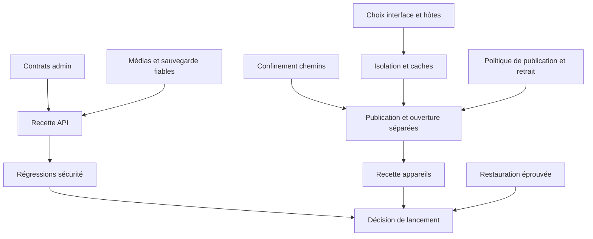

# TWA Store — Plan d’implémentation

> Audit du code accessible au 10 octobre 2026. **EXISTANT** : mécanisme constaté dans le code ; cela ne vaut pas recette en production. **PARTIEL** : chaîne incomplète ou incohérente. **ABSENT** : aucun mécanisme trouvé dans le périmètre examiné. **RECOMMANDÉ** : évolution proposée, non réalisée. **NON VÉRIFIÉ** : état inaccessible ou non testé.
>
> Références : **F:** = `/Users/apple/Documents/Quasar Projects/oneappapp/` ; **B:** = `/Users/apple/LaravelProjects/oneapp/`. Les chemins sont relatifs à ces racines. `Api/…Controller` désigne `B:app/Http/Controllers/Api/…Controller.php`. « TWA Store » est le nom demandé pour cette documentation ; le frontend affiche **PWA Store** et la vitrine Laravel **OneApp**. Aucun projet Android Trusted Web Activity n'a été identifié.

## Cadre d’exécution

Les chemins abrégés de pages renvoient à F:src/pages dans le sous-dossier store, auth, developer ou admin ; les classes Api sont dans B:app/Http/Controllers/Api. Les fichiers indiqués « futurs » sont proposés, pas présents dans le code audité.

Toutes les tâches ci-dessous sont **RECOMMANDÉES**, aucune n’a été implémentée pendant cet audit. « État actuel » décrit le constat source, pas l’avancement d’un ticket. Ne pas reconstruire l’authentification, le catalogue ou l’analyseur depuis zéro : corriger et compléter leurs contrats et garanties.

**Priorités.** P0 : bloqueur d’accès essentiel, de sécurité ou de lancement ; P1 : nécessaire à la fiabilité du MVP ; P2 : amélioration après stabilisation ; P3 : option selon stratégie. **Complexité indicative.** S : changement local ; M : plusieurs composants avec tests ; L : chaîne frontend/backend/stockage ou nouvelle capacité ; XL : décision d’architecture et migration opérationnelle. Ce sont des tailles relatives, pas des délais ni des engagements.

Les phases thématiques ne sont pas une invitation à reporter la sécurité : **C01 et C02 doivent commencer immédiatement**, avant toute ouverture publique de contenus tiers. A01 fixe la destination du produit. Les tests pertinents accompagnent chaque correction ; la phase E organise leur couverture et leur automatisation. Aucun travail de ce plan n’est autorisé par la seule mission documentaire actuelle.

## Phase A — Stabilisation

### A01 — Décider l’interface et le nom canoniques

**Fonctionnalité / constat :** Navigation et déploiement ; R11. **État actuel :** PARTIEL : Quasar PWA Store et Blade OneApp coexistent ; demande TWA Store.

**Priorité :** P1. **Complexité :** S. **Dépendances :** Aucune.

**Fichiers concernés :** F:src/router, layouts, quasar.config.js ; B:routes/web.php, resources/views.

**Action et résultat attendu — RECOMMANDÉ :** Consigner nom, hôtes, interface principale et stratégie de coexistence/retrait.

**Critères d’acceptation :** Une URL de recette identifiée par parcours ; aucune ambiguïté sur le frontend testé ; impact sur les liens historiques documenté.

### A02 — Réparer les contrats de modération

**Fonctionnalité / constat :** Administration ; R04. **État actuel :** PARTIEL : trois routes et un champ de statistiques divergents.

**Priorité :** P0. **Complexité :** M. **Dépendances :** Aucune pour la correction de contrat ; C03 pour la politique finale.

**Fichiers concernés :** F:src/pages/admin/AdminConsolePage.vue ; B:routes/api.php, Api/ApplicationController, Api/AnalyticsController.

**Action et résultat attendu — RECOMMANDÉ :** Employer les routes existantes PUT apps/id et GET analytics/summary/app_id ; afficher crashes_ratio correctement.

**Critères d’acceptation :** Admin approuve/quarantine/change le score et lit les stats ; non-admin reçoit 403 ; aucune action ne masque un échec HTTP.

### A03 — Séparer publication et ouverture publique

**Fonctionnalité / constat :** Installation ; R03/R07. **État actuel :** PARTIEL : bouton public appelle extraction protégée.

**Priorité :** P0. **Complexité :** L. **Dépendances :** C01, C02, C03 pour une ouverture sûre.

**Fichiers concernés :** F:src/pages/store/AppDetailsPage.vue ; B:Api/AppVersionController, StorefrontController.

**Action et résultat attendu — RECOMMANDÉ :** Ouvrir un runtime déjà publié et admissible ; réserver la publication aux acteurs autorisés.

**Critères d’acceptation :** Visiteur et rôle user ouvrent une fiche éligible sans POST extract ; version absente ou retirée donne un état clair ; propriétaire ne publie pas hors politique.

### A04 — Persister les captures et leurs suppressions

**Fonctionnalité / constat :** Médias ; R06. **État actuel :** PARTIEL : fichiers transmis mais pas de stockage durable.

**Priorité :** P1. **Complexité :** L. **Dépendances :** Aucune ; C04 pour les réponses publiques.

**Fichiers concernés :** F:src/pages/developer/CreateAppPage.vue, EditAppPage.vue, AppDetailsPage.vue ; B:Api/ApplicationController, config/filesystems.php.

**Action et résultat attendu — RECOMMANDÉ :** Contrat média durable avec upload, URL, conservation et suppression explicites.

**Critères d’acceptation :** Captures visibles après rechargement et depuis un autre navigateur ; suppression persistée ; fichiers invalides refusés ; accès limité au propriétaire pour modifier.

### A05 — Corriger la propagation des erreurs de sauvegarde

**Fonctionnalité / constat :** Édition et ZIP ; R09. **État actuel :** PARTIEL : saveAll poursuit après erreur ; code métier de reprise divergent.

**Priorité :** P1. **Complexité :** M. **Dépendances :** Aucune.

**Fichiers concernés :** F:src/pages/developer/EditAppPage.vue, DeveloperConsolePage.vue, CreateAppPage.vue ; B:Api/AppVersionController.

**Action et résultat attendu — RECOMMANDÉ :** Stopper la suite sur échec ; conserver fiche déjà créée et permettre reprise du seul build.

**Critères d’acceptation :** Un 422 de métadonnées ne téléverse pas de ZIP et ne redirige pas en succès ; reprise après échec ne recrée pas la fiche ; code d’erreur reconnu.

### A06 — Aligner configuration API, CSP et messages

**Fonctionnalité / constat :** Intégration navigateur ; R07. **État actuel :** PARTIEL : préfixe env à confirmer, médias/iframe bloquables, origines incohérentes.

**Priorité :** P1. **Complexité :** M. **Dépendances :** A01, C02.

**Fichiers concernés :** F:quasar.config.js, src/utils/media.js, index.html, AppDetailsPage.vue ; B:Api/AppVersionController.

**Action et résultat attendu — RECOMMANDÉ :** Origines explicites, variable de build fiable, messages contrôlés et médias autorisés au strict besoin.

**Critères d’acceptation :** Build de recette utilise son API sans repli local ; image/backend et aperçu blob fonctionnent ; message d’origine/source inattendue ignoré ; pas de wildcard inutile.

### A07 — Unifier session cliente et traitement du 401

**Fonctionnalité / constat :** Comptes ; R10. **État actuel :** PARTIEL : stockage supprimé mais Pinia peut rester connecté.

**Priorité :** P1. **Complexité :** M. **Dépendances :** A01 ; C05 pour durée et durcissement.

**Fichiers concernés :** F:src/stores/auth.js, src/boot/axios.js, src/router/index.js ; B:resources/js/app.js.

**Action et résultat attendu — RECOMMANDÉ :** Réhydratation serveur, purge unique et traitement du stockage corrompu.

**Critères d’acceptation :** Token révoqué provoque une seule sortie de session cohérente ; menus et garde synchronisés ; JSON invalide ne casse pas le démarrage ; retour de connexion défini.

## Phase B — Finalisation fonctionnelle

### B01 — Achever la bibliothèque et le suivi d’installation

**Fonctionnalité / constat :** Bibliothèque ; PR08/09. **État actuel :** PARTIEL : API présente, signal client incomplet.

**Priorité :** P1. **Complexité :** L. **Dépendances :** A03, A07.

**Fichiers concernés :** F:src/pages/store/AppDetailsPage.vue, routeur ; B:Api/InstallationController, resources/js/app.js, views/apps/library.blade.php.

**Action et résultat attendu — RECOMMANDÉ :** Relier les événements réels ou déclarés à un suivi clairement qualifié ; ouvrir un espace au rôle user.

**Critères d’acceptation :** Installation confirmée apparaît au bon compte ; annulation ne compte pas comme succès ; archivage et ouverture cohérents ; aucune fuite entre comptes.

### B02 — Normaliser versions, mises à jour et intentions

**Fonctionnalité / constat :** Distribution et reprise. **État actuel :** PARTIEL : tris divergents, GET mutatifs, comparaison par ID.

**Priorité :** P1. **Complexité :** M. **Dépendances :** A03, B01.

**Fichiers concernés :** B:Api/InstallationController, InstallIntentController, AppVersionController ; F:src/pages/store/AppDetailsPage.vue.

**Action et résultat attendu — RECOMMANDÉ :** Politique unique de version supérieure et consommation atomique des intentions ; reprise frontend.

**Critères d’acceptation :** Une version plus ancienne ne déclenche pas de mise à jour ; deux consommations concurrentes ne réussissent pas ; expiration testée ; lecture ne modifie pas silencieusement l’état.

### B03 — Définir puis réaliser le référencement par URL

**Fonctionnalité / constat :** Ambition produit PR11. **État actuel :** ABSENT : URL officielle seulement descriptive.

**Priorité :** P1 si retenu au MVP, sinon P2. **Complexité :** L. **Dépendances :** A01 et décision explicite URL versus ZIP ; C07.

**Fichiers concernés :** B:Api/ApplicationController, app/Services ; F:src/pages/developer/CreateAppPage.vue, EditAppPage.vue.

**Action et résultat attendu — RECOMMANDÉ :** Mode externe identifiable avec contrôles de disponibilité et propriété adaptés.

**Critères d’acceptation :** URL vérifiée sans accès à destinations internes ; redirects bornés ; indisponibilité/revalidation exposées ; aucune affirmation de contrôle avant réussite.

### B04 — Définir la preuve d’identité de l’éditeur

**Fonctionnalité / constat :** Confiance PR12. **État actuel :** ABSENT : rôle developer auto-déclaré.

**Priorité :** P1 si requis au lancement, sinon P2. **Complexité :** L. **Dépendances :** Décision produit sur niveau de preuve et données collectées ; C04.

**Fichiers concernés :** B:app/Models/User.php, contrôleurs et futurs éléments dédiés ; F:pages developer/admin.

**Action et résultat attendu — RECOMMANDÉ :** Workflow de demande, preuve, revue, refus et renouvellement ; badge après approbation uniquement.

**Critères d’acceptation :** Rôle seul ne donne pas un badge ; justificatifs non publics ; décision traçable ; accès aux preuves limité et durée de conservation définie.

### B05 — Rendre la récupération de compte opérationnelle

**Fonctionnalité / constat :** Comptes PR13. **État actuel :** ABSENT : bouton sans flux.

**Priorité :** P1. **Complexité :** M. **Dépendances :** A07, C05 ; configuration mail de recette.

**Fichiers concernés :** F:pages/auth, routeur ; B:routes/api.php, auth, config/mail.php.

**Action et résultat attendu — RECOMMANDÉ :** Récupération avec réponse neutre et lien expirant.

**Critères d’acceptation :** Compte existant/inexistant ne s’énumère pas par message ; lien utilisé/expiré refusé ; mot de passe changé et politique de révocation appliquée.

### B06 — Distinguer simulation et livraison des notifications

**Fonctionnalité / constat :** Push PR15. **État actuel :** PARTIEL : statut sent sans fournisseur.

**Priorité :** P2. **Complexité :** L. **Dépendances :** Choix produit d’activer le push ; B01, C05.

**Fichiers concernés :** B:Api/PushNotificationController, app/Models/PushNotification.php, config et jobs futurs.

**Action et résultat attendu — RECOMMANDÉ :** Retirer la promesse de livraison tant que simulée ; si retenu, intégrer consentement, abonnement et traitement réel.

**Critères d’acceptation :** Aucun faux statut livré ; destinataire autorisé ; échec/retry et désabonnement testés ; correspondance macos corrigée.

### B07 — Spécifier la contribution avant implémentation

**Fonctionnalité / constat :** Économie PR14. **État actuel :** ABSENT : aucun paiement ni facturation.

**Priorité :** P3. **Complexité :** L. **Dépendances :** Décision montant, déclencheur, débiteur et périmètre juridique.

**Fichiers concernés :** Documentation produit ; futurs modules séparés, aucune table de paiement actuelle à réutiliser fictivement.

**Action et résultat attendu — RECOMMANDÉ :** Spécification et choix fournisseur validés avant code.

**Critères d’acceptation :** Prix descriptif distingué du paiement ; critères remboursement/échec définis ; aucun écran ne prétend encaisser avant intégration testée.

### B08 — Raccorder la gestion des catégories

**Fonctionnalité :** BF04. **État actuel :** backend EXISTANT ; écran de gestion Quasar ABSENT. **Priorité :** P2, ou P1 si nécessaire aux administrateurs du MVP. **Complexité :** M. **Dépendances :** A01, A07.

**Fichiers concernés :** F:src/router/routes.js, src/pages/admin et navigation associée ; B:routes/api.php, app/Http/Controllers/Api/CategoryController.php ; tests de contrat futurs.

**Action et résultat attendu — RECOMMANDÉ :** créer une interface de liste/création/édition/suppression utilisant les cinq routes existantes ; exposer ordre, activation, icône et couleur. Ne pas dupliquer le référentiel dans le client.

**Critères d’acceptation :** l’admin peut créer et modifier une catégorie, choisir son ordre et son activation ; les non-admin reçoivent 403 aux mutations ; les erreurs de nom/slug sont lisibles ; suppression ne supprime pas les applications liées et l’interface explique le résultat.

### B09 — Raccorder et qualifier les mesures d’usage

**Fonctionnalité :** BF11. **État actuel :** ingestion et synthèse EXISTANTES ; instrumentation et fiabilité PARTIELLES. **Priorité :** P2, ou P1 si les indicateurs pilotent le lancement. **Complexité :** M. **Dépendances :** A02, A03, C05 ; politique de collecte F03.

**Fichiers concernés :** B:app/Http/Controllers/Api/AnalyticsController.php, app/Models/AnalyticsEvent.php ; F:src/pages/store/AppDetailsPage.vue, src/pages/admin/AdminConsolePage.vue ; ressources runtime retenues et tests futurs.

**Action et résultat attendu — RECOMMANDÉ :** définir la signification et la source de chaque événement, raccorder seulement les signaux effectivement observables, protéger l’ingestion contre les abus et afficher les agrégats existants avec leurs limites.

**Critères d’acceptation :** une action ne génère pas de doublons involontaires ; un clic d’intention n’est pas présenté comme une ouverture confirmée ; propriétaire/admin seuls lisent la synthèse ; le ratio serveur est rendu correctement ; les statistiques sans événements ne deviennent pas des données fictives ; tout suivi ajouté respecte la politique de données retenue.

## Phase C — Sécurité

### C01 — Confiner les chemins et borner les archives

**Fonctionnalité / constat :** Distribution ; R01. **État actuel :** PARTIEL : ZIP inspecté mais destination libre et limites non immédiatement bloquantes.

**Priorité :** P0. **Complexité :** L. **Dépendances :** Aucune.

**Fichiers concernés :** B:Api/ApplicationController::store/destroy, AppVersionController, app/Services/PwaPackageAnalyzer.php.

**Action et résultat attendu — RECOMMANDÉ :** Identifiants/version validés, noms de stockage internes, destination canonique confinée et arrêt aux quotas.

**Critères d’acceptation :** Identifiants absolus ou avec traversée refusés ; extraction/suppression ne sortent jamais de la racine ; ZIP surdimensionné interrompu avant épuisement ; liens dangereux traités ; tests en répertoire jetable.

### C02 — Isoler les runtimes et supprimer le cache de données privées

**Fonctionnalité / constat :** Hébergement et workers ; R02. **État actuel :** PARTIEL : même origine et cache GET trop large.

**Priorité :** P0. **Complexité :** XL. **Dépendances :** A01 pour hôtes cibles, sans attendre pour exclure les API du cache.

**Fichiers concernés :** B:Api/AppVersionController, public/oneapp-sw.js, resources/js/app.js ; F:src-pwa, AppDetailsPage.vue ; configuration hébergement future.

**Action et résultat attendu — RECOMMANDÉ :** Origines séparées entre plateforme et contenus non fiables ; workers/cache cloisonnés ; stratégie de purge des caches déjà créés.

**Critères d’acceptation :** PWA tierce ne lit ni token ni stockage de la plateforme ; aucune réponse /api privée en Cache Storage ; logout/reconnexion autre compte ne restaure aucune donnée précédente ; workers ne se désinscrivent pas mutuellement.

### C03 — Appliquer une politique unique de publication et de retrait

**Fonctionnalité / constat :** Autorisations ; R05. **État actuel :** PARTIEL : statut/is_active/version contrôlés différemment.

**Priorité :** P0. **Complexité :** L. **Dépendances :** Aucune pour la règle ; C02 pour retrait runtime cible.

**Fichiers concernés :** B:ApplicationController, AppVersionController, InstallationController, InstallIntentController, ReviewController, StorefrontController et service HTTP runtime.

**Action et résultat attendu — RECOMMANDÉ :** Matrice explicite rôle × fiche × version, réutilisée partout ; retrait effectif.

**Critères d’acceptation :** Pending/quarantined/inactive inaccessible publiquement dans recherche, détail, ZIP et runtime ; propriétaire consulte sans publier indûment ; version interdite non distribuée ; retrait de fichiers déjà publiés testé.

### C04 — Réduire les données publiques et neutraliser le HTML injecté

**Fonctionnalité / constat :** Données et XSS ; R08. **État actuel :** PARTIEL : modèles complets et interpolations non uniformes.

**Priorité :** P1. **Complexité :** M. **Dépendances :** Aucune.

**Fichiers concernés :** B:Api/ApplicationController, AppVersionController, Models/User.php, resources/js/app.js ; futurs serializers.

**Action et résultat attendu — RECOMMANDÉ :** Réponses publiques minimales et génération de contenu sans interpolation HTML non sûre.

**Critères d’acceptation :** Emails privés, chemins disque et rapports internes absents du public ; nom/icône contenant caractères HTML restent des données inertes ; schémas URL limités ; tests de régression ciblés.

### C05 — Durcir authentification et contrôle d’abus

**Fonctionnalité / constat :** Comptes et API ; R10. **État actuel :** PARTIEL : tokens sans durée par défaut, limiteur API absent.

**Priorité :** P1. **Complexité :** M. **Dépendances :** A01 pour stratégie de session.

**Fichiers concernés :** B:AuthController, bootstrap/app.php, config/sanctum.php, config/cors.php ; F:auth et axios.

**Action et résultat attendu — RECOMMANDÉ :** Durée/révocation définies, limites de tentatives et quotas adaptés, origines autorisées explicites.

**Critères d’acceptation :** Tentatives excessives donnent 429 sans bloquer indéfiniment les utilisateurs légitimes ; token expiré/révoqué refusé ; role admin impossible à obtenir à l’inscription ; aucune clé sensible exposée.

### C06 — Rendre publication et décisions traçables et réversibles

**Fonctionnalité / constat :** Déploiement et modération. **État actuel :** PARTIEL : remplacement destructif préalable, pas de trace métier structurée.

**Priorité :** P1. **Complexité :** L. **Dépendances :** C01, C02, C03.

**Fichiers concernés :** B:AppVersionController, ApplicationController ; stockage, modèles/migrations futurs si nécessaires.

**Action et résultat attendu — RECOMMANDÉ :** Vérifier intégrité, préparer version séparément, basculer atomiquement et journaliser l’acteur/la décision.

**Critères d’acceptation :** Échec avant bascule conserve l’ancienne version ; hash altéré refusé ; rollback démontré ; motif/date/acteur de modération consultables par rôle autorisé sans secrets dans les logs.

### C07 — Protéger les futures vérifications d’URL

**Fonctionnalité / constat :** Référencement externe. **État actuel :** ABSENT : aucune sonde, donc risque futur à prévenir.

**Priorité :** P1 conditionnel à B03. **Complexité :** M. **Dépendances :** Décision B03.

**Fichiers concernés :** Futur service B:app/Services de vérification distante, tests dédiés.

**Action et résultat attendu — RECOMMANDÉ :** Politique anti-SSRF, DNS/redirections contrôlés, temps/taille bornés.

**Critères d’acceptation :** Destinations privées/locales et rebindings refusés ; chaque redirection revalidée ; pas d’accès arbitraire depuis le serveur ; erreurs publiques ne divulguent pas d’infrastructure.

## Phase D — Expérience utilisateur

### D01 — Présenter des données et états honnêtes

**Fonctionnalité / constat :** Catalogue, fiche et formulaires ; R09/R12. **État actuel :** PARTIEL : notes/tailles/captures de secours et erreurs silencieuses.

**Priorité :** P1. **Complexité :** M. **Dépendances :** A04, A05.

**Fichiers concernés :** F:src/pages/store/StoreCatalogPage.vue, AppListPage.vue, AppDetailsPage.vue, pages/developer ; B:resources/js/app.js.

**Action et résultat attendu — RECOMMANDÉ :** États chargement/vide/erreur/succès uniformes, valeurs réelles ou absence explicite.

**Critères d’acceptation :** Zéro avis ne devient pas cinq étoiles ; aucun succès après échec ; absence média/version compréhensible ; promesses de certification non démontrées retirées.

### D02 — Exposer pagination et fiabiliser la recherche

**Fonctionnalité / constat :** Découverte ; R12. **État actuel :** PARTIEL : API paginée mais clients limités aux premiers résultats.

**Priorité :** P1. **Complexité :** M. **Dépendances :** Aucune.

**Fichiers concernés :** F:src/layouts/MainLayout.vue, AppListPage.vue, StoreCatalogPage.vue ; B:ApplicationController::index ; recherche Blade si conservée.

**Action et résultat attendu — RECOMMANDÉ :** Navigation de tous les résultats, requêtes coordonnées et URL partageable.

**Critères d’acceptation :** Plus de douze résultats restent atteignables ; filtre conservé au changement de page ; réponse ancienne ne remplace pas la nouvelle ; back/forward cohérents.

### D03 — Recetter accessibilité et responsive

**Fonctionnalité / constat :** Tous les parcours principaux. **État actuel :** NON VÉRIFIÉ : styles adaptatifs présents, recette manuelle absente.

**Priorité :** P1. **Complexité :** M. **Dépendances :** A02–A05 pour parcours fonctionnels.

**Fichiers concernés :** F:layouts, pages, src/css ; B:views/css si conservés.

**Action et résultat attendu — RECOMMANDÉ :** Corriger obstacles clavier, focus, annonces et contraste à partir du design existant.

**Critères d’acceptation :** Catalogue/auth/soumission/admin utilisables clavier seul et avec zoom ; modales gèrent le focus ; erreurs associées aux champs ; contrôle sur mobile et desktop consigné.

### D04 — Consolider marque, composants et liens

**Fonctionnalité / constat :** Design system ; R11. **État actuel :** PARTIEL : composants utiles, styles et liens inactifs dispersés.

**Priorité :** P2. **Complexité :** M. **Dépendances :** A01, D01.

**Fichiers concernés :** F:BrandLogo.vue, AppIcon.vue, layouts, css ; B:assets et vues selon choix.

**Action et résultat attendu — RECOMMANDÉ :** Marque et navigation cohérentes, cartes partagées si pertinent, liens utiles réels.

**Critères d’acceptation :** Chaque lien visible mène à une destination utile ou indique clairement son indisponibilité ; marque cohérente sur manifeste/login/erreurs ; thèmes relus sans régression.

## Phase E — Tests

### E01 — Mettre en place la recette API isolée et les contrats

**Fonctionnalité / constat :** Qualité frontend/backend. **État actuel :** PARTIEL : 4 Unit passés, 10 Feature inventoriés non exécutés ici.

**Priorité :** P1. **Complexité :** M. **Dépendances :** Environnement jetable autorisé ; A02, A04, A05.

**Fichiers concernés :** B:tests/Feature, tests/Unit, phpunit.xml ; F:futurs tests de contrat.

**Action et résultat attendu — RECOMMANDÉ :** Exécuter et compléter la couverture sur base dédiée, sans toucher aux données utilisateur.

**Critères d’acceptation :** Contrats admin, médias et erreurs testés ; tests HTTP n’utilisent jamais la base réelle ; résultat et version de code archivés ; aucun test trivial compté comme couverture métier.

### E02 — Automatiser les régressions de sécurité

**Fonctionnalité / constat :** R01/R02/R05/R08. **État actuel :** PARTIEL : tests ZIP et droits d’extraction limités.

**Priorité :** P0 pour les contrôles bloquants. **Complexité :** L. **Dépendances :** C01–C04 ; environnement isolé E01.

**Fichiers concernés :** B:tests/Unit, tests/Feature ; tests navigateur futurs.

**Action et résultat attendu — RECOMMANDÉ :** Matrice rôles/états et scénarios chemins/cache/origines/XSS.

**Critères d’acceptation :** Archives hostiles ne sortent pas du bac d’essai ; utilisateur A ne lit pas les données de B ; retrait bloque les accès ; code tiers ne contrôle pas le store ; échecs rendent la CI rouge.

### E03 — Recetter les parcours complets et appareils

**Fonctionnalité / constat :** Installation, publication, modération. **État actuel :** NON VÉRIFIÉ de bout en bout dans cet audit.

**Priorité :** P1. **Complexité :** L. **Dépendances :** A03–A07, B01 selon MVP, D03.

**Fichiers concernés :** F:parcours navigateur futurs ; B:tests ; documentation de recette.

**Action et résultat attendu — RECOMMANDÉ :** Recette réelle Android/iOS/desktop, réseau dégradé et annulation.

**Critères d’acceptation :** Dépôt → revue → publication → ouverture réussi ; installation annulée distinguée ; version retirée non ouvrable ; captures persistées ; preuves par navigateur/version.

### E04 — Automatiser lint, builds et suivi de dépendances

**Fonctionnalité / constat :** Maintenance et CI. **État actuel :** PARTIEL : lint local disponible, CI complète non trouvée.

**Priorité :** P2. **Complexité :** M. **Dépendances :** E01 et choix hébergement.

**Fichiers concernés :** F:package.json/quasar.config.js ; B:composer.json ; futurs fichiers CI.

**Action et résultat attendu — RECOMMANDÉ :** Pipeline reproductible sur versions verrouillées avec secret management du fournisseur.

**Critères d’acceptation :** Checkout propre produit lint/tests/build SPA/PWA retenu ; aucune migration de production au test ; échec bloque livraison ; résultats et artefacts consultables.

## Phase F — Préparation au lancement

### F01 — Valider le staging et le routage de production

**Fonctionnalité / constat :** Environnement. **État actuel :** NON VÉRIFIÉ : production et variables non inspectées.

**Priorité :** P1. **Complexité :** L. **Dépendances :** A01, A06, C02, E01.

**Fichiers concernés :** Configurations de déploiement futures ; F:quasar.config.js ; B:config et health /up.

**Action et résultat attendu — RECOMMANDÉ :** Hôtes, HTTPS, API, routes history et runtimes fonctionnent en staging représentatif.

**Critères d’acceptation :** Aucun repli vers oneapp.test ; refresh d’une route frontend fonctionne ; API distincte du repli SPA ; debug non public ; limites et permissions documentées.

### F02 — Mettre en place sauvegarde, restauration et surveillance

**Fonctionnalité / constat :** Exploitation. **État actuel :** NON VÉRIFIÉ : infrastructure réelle ; configuration logs standard seulement.

**Priorité :** P1. **Complexité :** L. **Dépendances :** F01, C06.

**Fichiers concernés :** B:config/logging.php, queue.php, filesystems.php ; runbooks et infrastructure futurs.

**Action et résultat attendu — RECOMMANDÉ :** Backups base/médias/paquets coordonnés, alertes et procédure de restauration.

**Critères d’acceptation :** Restauration réalisée en environnement isolé avec version cohérente ; alerte erreur de publication testée ; responsables et objectifs de reprise définis ; secrets exclus des logs.

### F03 — Arrêter périmètre, informations publiques et politique de données

**Fonctionnalité / constat :** Lancement produit. **État actuel :** PARTIEL : liens légaux et confiance inachevés.

**Priorité :** P1. **Complexité :** M. **Dépendances :** A01 ; décisions B03/B04/B07 ; C04.

**Fichiers concernés :** Documentation produit ; F:footer/pages ; B:conservation des données.

**Action et résultat attendu — RECOMMANDÉ :** Périmètre MVP signé, support réel, règles éditeur/modération et conservation communiquées.

**Critères d’acceptation :** Aucune fonction absente promise ; liens valides ; responsabilités de support définies ; inventaire des données et durée de conservation approuvés par le porteur.

### F04 — Prononcer la décision de lancement sur preuves

**Fonctionnalité / constat :** Ouverture publique. **État actuel :** PARTIEL : socle existant mais P0 ouverts.

**Priorité :** P0 comme porte de sortie. **Complexité :** M. **Dépendances :** Tous P0 ; tâches P1 retenues au MVP ; E02/E03, F01–F03.

**Fichiers concernés :** Sept documents d’audit, résultats de recette et runbook.

**Action et résultat attendu — RECOMMANDÉ :** Revue go/no-go, liste de limites acceptées et rollback prêt.

**Critères d’acceptation :** Aucun P0 non résolu ; cinq parcours critiques réussis ; isolation et retrait démontrés ; restauration prouvée ; aucun compte de démonstration privilégié actif non maîtrisé.

## Ordonnancement et responsabilités suggérés

Le responsable produit tranche A01 et les capacités conditionnelles B03/B04/B07. Backend et exploitation traitent C01/C02/C03 avec revue de sécurité ; frontend et backend réparent A02/A03 en parallèle conceptuel, après définition des contrats. A04/A05 et A07 rendent ensuite les parcours fiables. Les tests sont écrits avec les correctifs, puis exécutés en staging par E01–E03. D03 et F02 doivent être terminés avant la revue de lancement retenue.

Aucune date ni estimation de pourcentage n’est fixée sans capacité d’équipe et périmètre acceptés. Les tâches P2/P3 peuvent être différées explicitement ; une faiblesse P0 ne doit pas être dissimulée par un changement de libellé dans l’interface.

## Les cinq premières actions

1. **C01 :** confiner les chemins de stockage/extraction/suppression et arrêter les archives hors limites.
2. **C02 :** séparer l’origine des contenus tiers et empêcher le cache de réponses privées.
3. **A03 + C03 :** ouvrir une version déjà publiée et autorisée, avec retrait effectif.
4. **A02 :** raccorder modération et statistiques aux contrats backend existants.
5. **A04 + A05 :** rendre médias et sauvegardes durables, avec reprise après erreur sans faux succès.

Ces actions corrigent des fonctions existantes ; elles ne constituent pas un projet de réécriture. La décision de nom et d’interface A01 peut être prise immédiatement pour éviter de réaliser la recette sur la mauvaise vitrine.

## Raccordement des fonctionnalités Laravel existantes

Le [catalogue BF](./01_TWA_STORE_PRD.md#catalogue-fonctionnel-laravel-et-intégration-dans-quasar) sert de base : ne pas redévelopper les opérations déjà présentes. Compléter leur exposition et corriger les limites constatées.

| Fonctions backend                    | Travail déjà planifié        | Nature du travail                                                                  |
| ------------------------------------ | ---------------------------- | ---------------------------------------------------------------------------------- |
| BF01 comptes                         | A07, B05, C05                | Fiabiliser session ; ajouter uniquement la récupération absente                    |
| BF02/BF03 catalogue et gestion       | A02, A04, A05, C03, D01, D02 | Réparer contrats/données/visibilité ; exploiter pagination existante               |
| BF04 catégories                      | B08 (phase B)                | Ajouter le client d’administration à l’API existante                               |
| BF05 versions/distribution           | A03, A06, C01, C02, C06      | Séparer et sécuriser les opérations existantes                                     |
| BF06 avis                            | C04, D01, E01                | Conserver l’API et fiabiliser validation, concurrence et retours                   |
| BF07/BF08 bibliothèque/installations | B01, B02                     | Raccorder POST/PATCH/GET et distinguer archive/désinstallation                     |
| BF09 intentions                      | B02                          | Consommation sûre et reprise cliente                                               |
| BF10 notifications                   | B06                          | Livraison réelle à développer ; stockage existant à conserver selon contrat retenu |
| BF11 analytics                       | A02 et B09 (phase B)         | Réparer lecture admin et compléter instrumentation/qualité des mesures             |
| BF12/BF13 vitrine et PWA Blade       | A01, A06, C02, D04           | Décider coexistence, préserver parcours retenus et éviter conflits de workers      |

## Documents associés

[00](./00_TWA_STORE_AUDIT_SUMMARY.md) · [01](./01_TWA_STORE_PRD.md) · [02](./02_TWA_STORE_TRD.md) · [03](./03_TWA_STORE_APP_FLOW.md) · [04](./04_TWA_STORE_UX_UI.md) · [05](./05_TWA_STORE_BACKEND_SCHEMA.md) · [06](./06_TWA_STORE_IMPLEMENTATION_PLAN.md)

## Mise en œuvre du 11 octobre 2026

Le plan validé a été mis en œuvre progressivement dans les deux projets existants. La préférence explicite de l’utilisateur prévaut : **pile système sans-serif de Tailwind**, sans chargement d’Inter ou d’Inter Tight.

### Livré dans le code

- Compte unique Sanctum : inscription sans choix de rôle, vérification d’e-mail par code OTP, mise à jour du profil, favoris idempotents et bibliothèque existante.
- Profil développeur individuel ou organisation rattaché à `users.id`, activation idempotente sous verrou transactionnel, cinq statuts, transitions contrôlées et historique. La suspension préserve le compte utilisateur.
- Autorisations serveur distinctes pour préparer et soumettre. Un e-mail confirmé, un profil complet vérifié et une pièce d’identité non expirée sont requis pour soumettre (`User::publicationBlockers()` expose les motifs au front) ; chaque produit et chaque version nécessitent une revue indépendante. L’administrateur ne peut pas approuver son propre produit/profil.
- Référencement HTTPS : validation des adresses, rejet des réseaux non publics, résolution DNS contrôlée et épinglée, validation de chaque redirection, taille et durée limitées, contrôle statique du manifeste et empreinte de contenu. Commande périodique de contrôle et mise en quarantaine des changements.
- Builds : contrôles des chemins, liens symboliques, extensions, taille décompressée, nombre de fichiers, ressources externes déclarées, empreinte et nouvelle analyse avant publication. Stockage privé, publication sur `pwa-{id}.{PWA_RUNTIME_DOMAIN}`, origine différente par application, version active interchangeable avec une ancienne version approuvée. Le runtime ne transmet pas les requêtes aux API Laravel.
- Paramètres de quotas centralisés dans `config/pwa_store.php`. Valeurs commerciales non fixées, aucun prestataire ni encaissement ajouté. Le dépassement bloque les nouvelles soumissions concernées.
- Pièce d’identité obligatoire (carte nationale, passeport, titre de séjour ou permis ; celle du représentant pour une organisation) avec date d’expiration future, exigée pour soumettre le profil et pour sa vérification. Une pièce expirée bloque la publication ; son renouvellement renvoie le profil en vérification. Migration `2026_10_11_000007_add_developer_identity_document.php`.
- Justificatifs complémentaires uniquement sur demande motivée d’un administrateur : PDF/JPEG/PNG de 5 Mo maximum, stockage privé, téléchargement authentifié en pièce jointe, journal des consultations et suppression à la demande. Expiration configurable, 30 jours par défaut technique ; commande quotidienne de purge.
- Capture d’écran réelle enregistrée côté serveur. Suppression des images de démonstration dans les fiches publiques.
- Pages compte, activation/profil/quotas, publication/versions et revue des développeurs. Navigation, guards, session et erreurs raccordés aux vrais endpoints.
- Authentification compacte et responsive, thèmes clair/sombre, police système globale, animations GSAP chargées à la demande, réduction des mouvements, parallaxe limitée au bureau et animations décoratives suspendues hors écran.

### Migrations et installation locale

Trois migrations additives :

1. `2026_10_11_000001_add_developer_accounts.php` : profils, historique et favoris.
2. `2026_10_11_000002_add_publication_workflow.php` : distribution, modération des versions et événements de publication. Les étapes sont reprenables après une interruption DDL MySQL.
3. `2026_10_11_000003_add_developer_documents.php` : justificatifs privés et expiration.

Une sauvegarde SQL privée de la base locale a été créée avant la tentative de migration : `/private/tmp/pwa-local-backup-20261011-105427/database.sql`. Aucun reset ni migration de production n’a été exécuté.

**Installation locale terminée** : après accord explicite de l’utilisateur, la connexion inactive 101 a été fermée. Les migrations 2 et 3 ont été appliquées avec succès ; les trois migrations sont enregistrées dans MySQL. La reprise a conservé les colonnes déjà ajoutées, sans réinitialisation de la base.

### Contrats API ajoutés ou adaptés

| Parcours                 | Endpoints                                                                                                                                               |
| ------------------------ | ------------------------------------------------------------------------------------------------------------------------------------------------------- |
| Compte                   | `POST /auth/register`, `POST /auth/login`, `GET /auth/me`, `PUT /account`                                                                               |
| E-mail                   | `POST /auth/email/resend`, `POST /auth/otp/verify`, `POST /auth/otp/resend` ; ancien lien signé supprimé                                                |
| Favoris                  | `GET /favorites`, `PUT /favorites/{application}`, `DELETE /favorites/{application}`                                                                     |
| Développeur              | `POST /developer/activate`, `GET/PUT /developer/profile`, `POST /developer/profile/submit`, `POST /developer/profile/identity`, `GET /developer/quotas` |
| Revue éditeur            | `GET /admin/developers`, `POST /admin/developers/{profile}/review`                                                                                      |
| Justificatifs            | `GET/POST /developer-profiles/{profile}/documents`, `POST/GET/DELETE /developer-documents/{document}`                                                   |
| Distribution             | `PUT /apps/{application}/source`, `POST /apps/{application}/check-url`, `POST /apps/{application}/submit`                                               |
| Revue produit/version    | `POST /admin/apps/{application}/review`, `POST /admin/versions/{version}/review`                                                                        |
| Publication et ouverture | `POST /versions/{version}/extract` réservé à la publication ; `GET /apps/{application}/launch` pour l’ouverture publique                                |
| Médias                   | `GET /media/screenshots/{file}` ; fichiers reçus par `POST/PUT /apps`                                                                                   |
| Compatibilité            | API applications, versions, bibliothèque/installations, téléchargements et intentions adaptées aux états publiés/autorisés                              |

Les chemins du tableau sont préfixés par `/api`. Les détails d’authentification, validations et réponses restent dans les contrôleurs et les tests livrés ; aucune deuxième authentification n’a été introduite.

### Vérifications du lot initial

- PHPUnit sur copie isolée du backend, SQLite en mémoire, mail/cache/session de test : **39 tests, 153 assertions, tous réussis**. Cette suite isolée n’utilise pas la base métier.
- Contrôles couverts : compte simple, activation répétée, transitions de vérification, soumission, autorisations, suspension, quotas, approbation indépendante des versions, adresses interdites et classification IP, médias, favoris, justificatifs privés/expiration/suppression, isolation des routes du runtime, bibliothèque et reprise de migration.
- Formatage et analyse frontend : `npm run lint:check`.
- Builds Quasar SPA et PWA exécutés avec succès. À relancer après toute modification ultérieure.
- Chrome : connexion et inscription à 320, 390, 1024 et 1440 px. Contrôle des nouvelles pages à 320, 390 et 1440 px, dans les deux thèmes ; correction du débordement du titre des justificatifs. Fond de présentation clair `rgb(237, 243, 255)`, sombre `rgb(8, 19, 45)`.
- Contrôle supplémentaire sur le véritable noyau HTTP Laravel et MySQL local : **10 requêtes conformes** (compte, double activation sans doublon, profil, quotas, favoris, bibliothèque, justificatifs et deux refus 403 attendus). Utilisateur de contrôle créé dans une transaction annulée ; nombres de lignes identiques avant/après sur les huit tables vérifiées. L’authentification de ce contrôle est injectée dans la garde Sanctum : il ne remplace pas une recette navigateur de connexion par jeton.
- Les contrôles navigateur des comptes protégés utilisent des réponses API interceptées en mémoire, uniquement dans le script de test. Ils prouvent l’affichage et l’absence d’erreurs JavaScript, pas une intégration de bout en bout avec MySQL ou un serveur SMTP réel. Les autorisations sont couvertes séparément par les tests HTTP Laravel.

### Prérequis d’exploitation et limites vérifiées

- Les migrations locales sont terminées. Prévoir la procédure normale de déploiement, sauvegarde et validation pour la production.
- Vérifier `PWA_FRONTEND_URL` et configurer `PWA_RUNTIME_DOMAIN` sur un domaine distinct, DNS et certificat wildcard. Le SMTP local est configuré et son authentification STARTTLS est validée ; la réception effective reste à vérifier. Le proxy doit transmettre ces hôtes au middleware Laravel et ne pas servir directement les archives privées. La publication échoue explicitement si le domaine isolé est absent.
- Désactiver tout ancien accès statique à `/apps/{identifier}/...` côté serveur Web avant une exposition publique ; les anciennes applications doivent être revues et redéployées sur le runtime isolé. Un service worker déjà installé doit être pris en compte dans cette migration.
- Exécuter le scheduler Laravel pour `pwa:check-external` et `pwa:purge-documents`. Définir la durée de conservation appropriée et aligner les sauvegardes sur la politique de suppression ; la purge applicative ne purge pas les sauvegardes externes.
- L’analyse est statique : ce n’est pas une certification de sécurité. Les scripts distants peuvent évoluer sans changer l’HTML ou le manifeste ; revue humaine et supervision restent nécessaires. Aucun script soumis n’est exécuté sur le serveur.
- Livraison SMTP, hébergement public avec DNS/TLS, service workers/installations sur appareils réels, performances sur appareils modestes et restauration de la sauvegarde n’ont pas été validés ici.
- Les tâches avancées de l’audit initial (récupération de mot de passe, livraison push réelle, administration complète des catégories, amélioration des mesures analytiques et recette multi-appareils) restent distinctes de ce lot. Aucun faux succès ne les remplace.

### Fichiers modifiés ou ajoutés

Frontend, par rapport à l’état Git courant (inclut les changements de présentation déjà en cours au début de ce lot) :

- `package-lock.json`
- `package.json`
- `src/boot/axios.js`
- `src/components/DeveloperDocuments.vue`
- `src/composables/usePageMotion.js`
- `src/css/app.scss`
- `src/css/quasar.variables.scss`
- `src/css/theme.scss`
- `src/layouts/AuthLayout.vue`
- `src/layouts/DeveloperLayout.vue`
- `src/layouts/MainLayout.vue`
- `src/pages/account/AccountPage.vue`
- `src/pages/admin/AdminConsolePage.vue`
- `src/pages/admin/DeveloperReviewPage.vue`
- `src/pages/auth/LoginPage.vue`
- `src/pages/auth/RegisterPage.vue`
- `src/pages/developer/DeveloperConsolePage.vue`
- `src/pages/developer/DeveloperProfilePage.vue`
- `src/pages/developer/EditAppPage.vue`
- `src/pages/developer/PublicationPage.vue`
- `src/pages/store/AppDetailsPage.vue`
- `src/pages/store/StoreCatalogPage.vue`
- `src/router/index.js`
- `src/router/routes.js`
- `src/services/account.js`
- `src/stores/auth.js`

Backend Laravel :

- `app/Http/Controllers/Api/AccountController.php`
- `app/Http/Controllers/Api/AppVersionController.php`
- `app/Http/Controllers/Api/ApplicationController.php`
- `app/Http/Controllers/Api/AuthController.php`
- `app/Http/Controllers/Api/DeveloperDocumentController.php`
- `app/Http/Controllers/Api/DeveloperProfileController.php`
- `app/Http/Controllers/Api/InstallIntentController.php`
- `app/Http/Controllers/Api/InstallationController.php`
- `app/Http/Controllers/Api/PublicationController.php`
- `app/Http/Controllers/StorefrontController.php`
- `app/Http/Middleware/ServePwaRuntime.php`
- `app/Models/AppVersion.php`
- `app/Models/Application.php`
- `app/Models/DeveloperDocument.php`
- `app/Models/DeveloperProfile.php`
- `app/Models/DeveloperProfileEvent.php`
- `app/Models/User.php`
- `app/Services/ApplicationMedia.php`
- `app/Services/ExternalPwaChecker.php`
- `app/Services/PublicationQuota.php`
- `app/Services/PwaPackageAnalyzer.php`
- `app/Services/PwaRuntime.php`
- `bootstrap/app.php`
- `config/pwa_store.php`
- `database/migrations/2026_10_11_000001_add_developer_accounts.php`
- `database/migrations/2026_10_11_000002_add_publication_workflow.php`
- `database/migrations/2026_10_11_000003_add_developer_documents.php`
- `public/oneapp-sw.js`
- `routes/api.php`
- `routes/console.php`
- `tests/Feature/AppVersionExtractionRouteTest.php`
- `tests/Feature/DeveloperAccountTest.php`
- `tests/Feature/DeveloperDocumentTest.php`
- `tests/Feature/IsolatedRuntimeTest.php`
- `tests/Feature/PublicationWorkflowTest.php`
- `tests/Feature/StorefrontTest.php`
- `tests/TestCase.php`
- `tests/Unit/ExternalPwaCheckerTest.php`

## Complément livré : Country, OTP et tableau de bord adaptatif

Les demandes complémentaires sont intégrées dans Laravel et Quasar. Les migrations `000004_add_countries_and_email_otp` et `000005_extend_device_library` ont été appliquées à MySQL local après sauvegarde privée (`/private/tmp/pwa-local-backup-20261011-171214/database.sql`). Les comptes et les applications existants sont conservés ; les anciennes sessions de comptes non confirmés doivent désormais confirmer leur e-mail.

- Référentiel de 249 pays, relations utilisateurs/développeurs/disponibilité des applications, sélection dans les formulaires et statistiques d’administration.
- Inscription confirmée exclusivement par OTP e-mail avant remise d’un jeton. Connexion avec OTP uniquement lorsque la double authentification est activée, sauf confirmation initiale encore manquante. Activation et désactivation protégées par mot de passe et code. Changement d’adresse protégé et différé jusqu’à confirmation.
- SMTP configuré dans le fichier privé ; connexion, authentification et exigence TLS vérifiées. Aucun secret n’est enregistré dans ces documents.
- Mon espace devient un tableau de bord pour les développeurs sur ordinateur/tablette ; sous 768 px, il présente uniquement les fonctions utilisateur. Les liens développeurs et les navigations directes sont traités de façon cohérente.
- Bibliothèque filtrée par compte et navigateur : téléchargements enregistrés et installations déclarées, avec confirmation et désinstallation depuis l’interface. Aucune prétention à détecter toutes les installations natives du terminal.

### Validation de ce complément

- **58 tests backend et 262 assertions réussis**, en environnement SQLite isolé avec e-mails simulés : non-délivrance anticipée de jeton, expiration, cinq essais, renvoi temporisé, invalidation des anciens codes, absence de contournement de la double authentification, révocation de sessions, changement d’e-mail, référentiel Country, isolation du tableau de bord, bibliothèque par terminal et conservation d’un état installé lors d’un téléchargement.
- **19 contrôles HTTP sur MySQL local réussis**, avec de vrais jetons Sanctum. Créations effectuées dans une transaction annulée ; nombres de lignes identiques après contrôle sur les tables concernées. Aucun destinataire réel contacté.
- Chrome : inscription avec pays et OTP, refus d’un code erroné, absence de jeton avant OTP, connexion avec double authentification et confirmation du changement de réglage. Tableau de bord/espace utilisateur testés à **320, 390, 768 et 1440 px**, dans les deux thèmes, sans débordement horizontal. Ces scénarios utilisent une API interceptée exclusivement dans le script de test.
- Contrôle navigateur supplémentaire **sans simulation** : Quasar charge réellement les 249 pays depuis Laravel et permet de sélectionner la Côte d’Ivoire sur mobile, sans soumettre d’inscription.
- Lint, builds Quasar SPA/PWA et build Vite de la vitrine Laravel réussis.
- Connexion SMTP et authentification réussies avec TLS obligatoire. Réception effective d’un e-mail, classement antispam et installations de PWA sur appareils physiques non validés par ces contrôles.

Les détails des relations Country et leurs liens possibles avec les autres entités sont dans [05 — Schéma backend](./05_TWA_STORE_BACKEND_SCHEMA.md#évolution-appliquée--country-otp-et-bibliothèque-par-appareil-11-octobre-2026). Les contrats OTP et la règle d’affichage sont dans [02 — TRD](./02_TWA_STORE_TRD.md#contrats-livrés--otp-country-et-espace-adapté-11-octobre-2026).

### Principaux fichiers de ce complément

Backend : modèles `Country`, `AuthChallenge`, `User`, `DeveloperProfile`, `Application`, `Installation` ; service `EmailOtp` ; e-mail `AuthenticationCode` ; contrôleurs `AuthController`, `AccountController`, `CountryController`, `DeveloperDashboardController`, `DeveloperProfileController`, `ApplicationController`, `InstallationController` ; référentiel `database/data/countries.php` ; deux migrations ; `config/mail.php`, routes API/console et formulaire de connexion `resources/js/app.js`. Tests : `EmailOtpTest`, `CountryAndDashboardTest`, adaptations des tests de compte et de publication.

Frontend : `CountrySelect`, `AccountSecurity`, `DeveloperOverview`, `PersonalLibrary` ; pages `VerifyEmailPage`, `CountryOverviewPage`, refonte de `AccountPage` et adaptations des formulaires d’inscription, connexion, profil développeur et applications ; `useWorkspaceAccess`, `utils/device`, store d’authentification, router, navigation principale, accueil et fiche application.

### Validation développeur et correction navigateur — 12 octobre 2026

- `media.js` utilise uniquement `import.meta.env.VITE_API_URL` et la valeur locale de secours ; aucune variable Node `process` n’est nécessaire dans le navigateur.
- La soumission du profil et son approbation appliquent les mêmes champs obligatoires : type, nom public, identité légale, pays ; représentant et e-mail professionnel pour une organisation. L’e-mail du compte et la pièce d’identité doivent également être valides.
- La capacité de publier exige un profil complet, une identité non expirée, le statut vérifié et une décision de validation conservée dans `developer_profile_events`. Le rôle administrateur ne dispense plus son propre compte développeur de ces exigences. La création et la modification d’applications, y compris les brouillons, exigent également cette validation. Seule la préparation du profil développeur reste accessible avant validation.
- Le profil expose `missing_fields` et `validation` (identifiant et nom de l’administrateur, date), affichés dans le portail développeur et la revue administrative. La dernière validation reste consultable après une suspension. L’historique existant sert de référence sans migration ni attribution inventée pour les anciens profils.
- Un ancien profil marqué vérifié mais incomplet ou sans décision enregistrée ne peut plus publier. Un administrateur peut le suspendre puis le rouvrir en brouillon pour compléter et refaire la validation.
- Les coordonnées privées de l’administrateur ne sont pas exposées. Si son compte a été supprimé, l’interface l’indique.
- Vérification : 112 tests Laravel, 741 assertions, sur SQLite isolé.

- Précision du 12 octobre : `developer.app.create` et `developer.app.update` appliquent les mêmes conditions que la soumission. Les routes frontend de création et modification redirigent vers le profil en l’absence de validation ; les boutons sont désactivés et l’API refuse les opérations. Les applications existantes ne sont pas supprimées.
